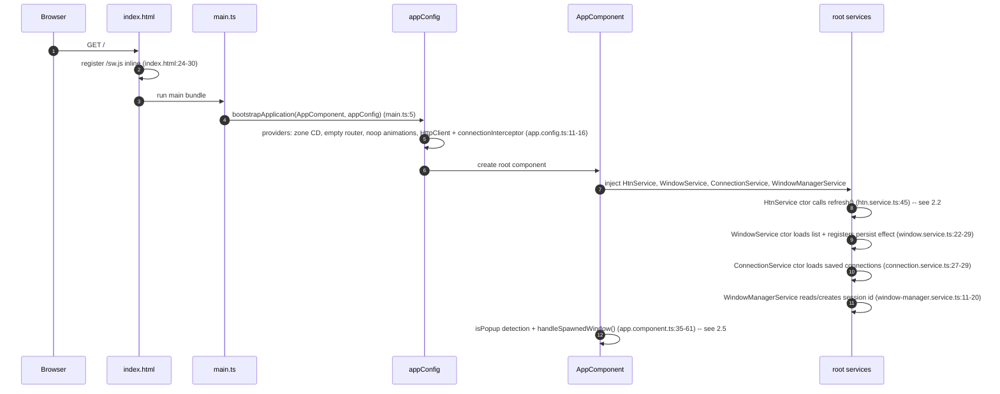
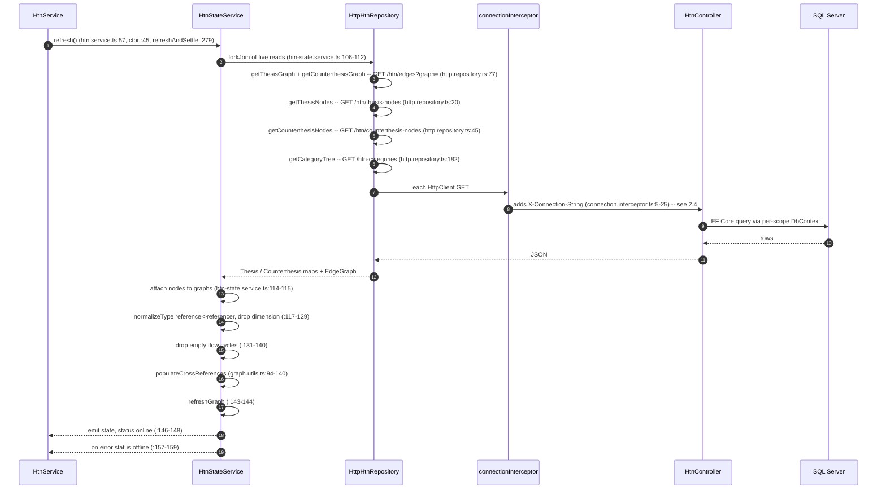
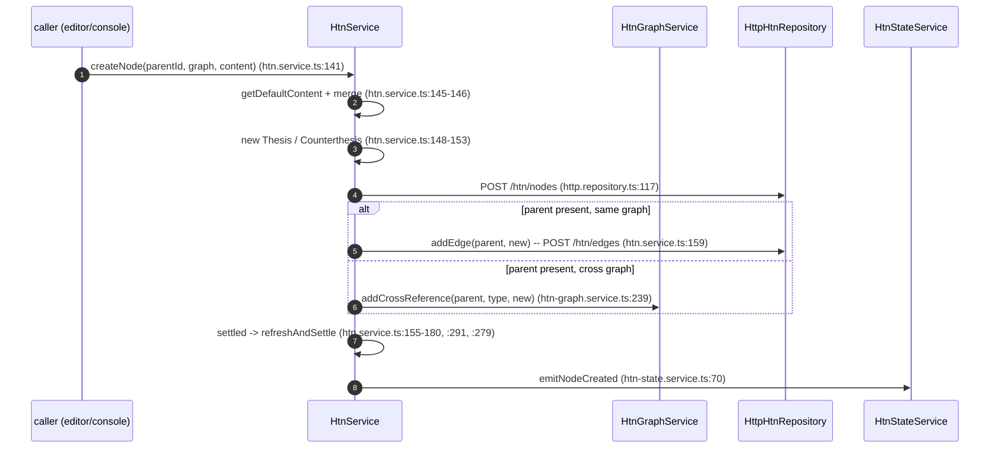
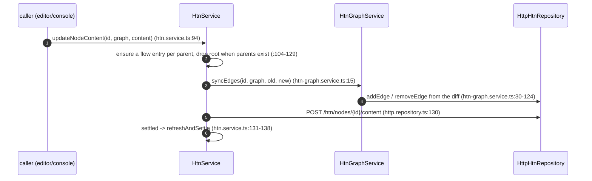
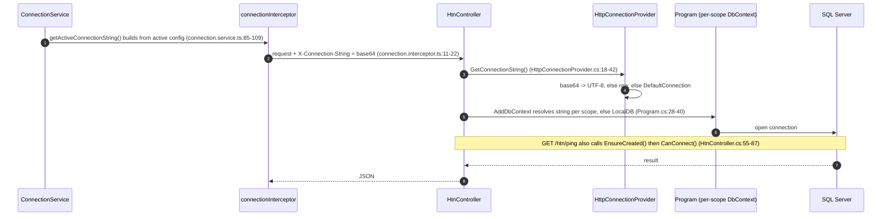
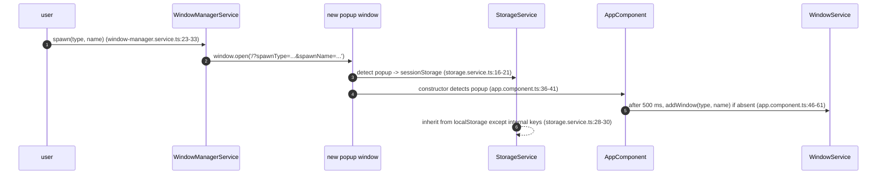

# ERE — Architecture

> **Status: audited (2026-10-10, ROADMAP T8.1).** Written against the code as it exists today;
> every load-bearing claim cites `file:line`, and the T8.1 audit re-read each claim against the
> tree. This document is the record of **reality**, not intent; where the entry-point docs
> disagreed with the code, the code won (recorded in §6 and fixed in T7.1; the redundant
> `DOCUMENTATION.md` was then removed — D15).

> ERE (Explicit Resolution Engine) models and resolves complex problems as a **dialectic
> graph**: **Thesis** nodes (structures/regularities) and **Counterthesis** nodes
> (processes/flows). It is an infra monorepo whose two halves are independent git submodules:
> `resolution-engine` (.NET 9 ASP.NET Core API over SQL Server via EF Core) and
> `shiny-computing-machine` (package name **`purgatory-ui`** — an Angular 20 signal-heavy SPA
> with a custom window system). The graph algorithms live in the **frontend**.

## 1. Repository Layout

```
ere-infra/                         # integration/infra root — itself a git repo
├── AGENTS.md                      # workflow / context-management rules
├── README.md                      # entry-point doc (corrected in T7.1)
├── docker-compose.yml             # the whole stack (db / backend / frontend-prod|dev)
├── .gitmodules                    # declares the two submodules
├── backups/                       # bind-mounted into the db container
├── exported-plan.json             # sample data export (nested thesis/process plan)
├── resolution-engine/             # submodule — .NET 9 backend (own .git/)
├── shiny-computing-machine/       # submodule — Angular 20 frontend (own .git/)
└── docs/                          # THIS documentation set
    ├── ARCHITECTURE.md            # this file
    ├── PROJECT_STATE.md
    ├── ROADMAP.md
    ├── DECISIONS.md
    ├── CURRENT_TASK.md
    └── PRODUCTION_CHECKLIST.md
```

The two halves are independently versioned: each submodule has its own `.git/` and is wired in
via `.gitmodules`; the root repo is the only place that sees the whole system (D1).

- **`resolution-engine`** — REST API; dev host `http://localhost:5250`, in-container `:8080`.
- **`shiny-computing-machine`** — browser SPA (project/package `purgatory-ui`); dev server
  `:4250` (`npm start`, `package.json:8`), production served by nginx on `:4200→80`.
- **SQL Server 2022** — container `:1433`, named volume `mssql_data`.

## 2. System Context / Data Flow

```
                         ┌──────────────────────────────────────────────┐
                         │        browser SPA: purgatory-ui             │
                         │  Angular 20 · signals · window system        │
                         │  graph algorithms (core/domain/graph.utils)  │
                         └───────────────┬──────────────────────────────┘
                                         │ HTTP/JSON
                                         │ X-Connection-String: <base64 or raw conn string>
                                         ▼
                         ┌──────────────────────────────────────────────┐
                         │        resolution-engine (.NET 9)            │
                         │  Controllers → EF Core (ApplicationDbContext)│
                         │  connection resolved PER REQUEST             │
                         └───────────────┬──────────────────────────────┘
                                         │ SQL (Microsoft.Data.SqlClient)
                                         ▼
                         ┌──────────────────────────────────────────────┐
                         │   SQL Server 2022 (Docker :1433)             │
                         │   HtnNodes · HtnEdges · HtnCategoryDoc       │
                         └──────────────────────────────────────────────┘
```

Load-bearing facts:

- **The DB connection is resolved per request.** The SPA may attach an `X-Connection-String`
  header (base64 or raw) on every call; the backend prefers it, then falls back to config
  `DefaultConnection`, then to LocalDB. This is the distinctive multi-tenant / multi-database
  seam and the reason a DbContext is built per scope (`resolution-engine/Program.cs:28-40`,
  `resolution-engine/Services/HttpConnectionProvider.cs:18-42`). See §3.4.
- **The graph algorithms live in the SPA, not the backend.** Topological layering and
  thesis/counterthesis cross-reference population are in
  `shiny-computing-machine/src/app/core/domain/graph.utils.ts` (D6). The backend only stores
  nodes/edges and an opaque `layer` blob.
- **No authentication anywhere.** There are no identity, token, or CORS-restriction seams; the
  API is open (see §6).
- `exported-plan.json` at the root is a sample data export (a nested thesis/process plan), not
  source.

### 2.1 SPA bootstrap & shell

Startup order (all paths are relative to `shiny-computing-machine` unless noted):



- `provideRouter(routes)` is configured, but `app.routes.ts` is **empty** (`app.routes.ts:3`), so
  `<router-outlet />` renders nothing; the app is one shell (D12).
- The shell renders every open window from `WINDOW_REGISTRY` via `ngComponentOutlet`
  (`core/config/window-registry.ts:10-18`), so a feature component is constructed only when a
  window of its type is open.
- `WindowService` auto-persists the window list on every change through an `effect`
  (`window.service.ts:26-28`) via `StorageService` (localStorage, or sessionStorage in popups —
  §2.5).

### 2.2 Read path — the refresh pipeline

`refresh()` is the single read entry point. It is triggered from the `HtnService` constructor
(`htn.service.ts:45`), from explicit `refresh()` calls (`htn.service.ts:57`), and after every
write via `refreshAndSettle()` (`htn.service.ts:279-289`).



- The five requests run in parallel (`forkJoin`); the state is only emitted once all succeed —
  any failure moves the connection status to `offline` and leaves the previous state in place.
- `getThesisNodes`/`getCounterthesisNodes` map raw JSON into `Thesis`/`Counterthesis`
  (`http.repository.ts:25-32,50-57`); the graph reads build adjacency lists
  (`http.repository.ts:88-93`).

### 2.3 Write path — create and update

**Create** (`createNode`):



**Update** (`updateNodeContent`):



- **Edge direction** depends on graph and field (`htn-graph.service.ts:30-50`): thesis
  `triggers` → `addEdge(id, target)` and `effects` → `addEdge(effect, id)`; counterthesis
  `triggers` → `addEdge(trigger, id)` and `effects` ->`addEdge(id, effect)`. Cross-list
  membership (`countertheses`/`theses`) is mirrored through `addCrossReference`.
- **Deletes** go through `performComplexRemoval` (mode `recursive`/`subtree`/`cascade`,
  `htn-graph.service.ts:301-340`) and batch-delete (`http.repository.ts:149`); the backend
  cascades the corresponding edges (§3.2).
- `importNodes` (`htn.service.ts:310-345`) runs the same create/update primitives per node in a
  single `forkJoin`.

### 2.4 Connection resolution + ping / `EnsureCreated`

The client half is the interceptor; the server half is `HttpConnectionProvider`. Ping is the
bootstrap probe used to create/verify a database.



- A header value that is not valid base64 is used verbatim as the raw connection string
  (`HttpConnectionProvider.cs:33-37`).
- `ping` is the only path that **creates** schema on a fresh database (`EnsureCreated()`,
  `HtnController.cs:68`); `debug-connection` echoes the masked string and all headers
  (`:89-98`) — see §6.

### 2.5 Window spawn (popup) lifecycle

`WindowManagerService.spawn` opens a real browser popup; the popup detects itself and re-adds
the requested window.



- Popup detection is `window.opener` **or** the `/popup` path **or** a `spawnType` query param
  (`storage.service.ts:16`); the same prefixes drive `AppComponent.isPopup`
  (`app.component.ts:36-41`).
- `EXCLUDED_FROM_INHERITANCE` (`shiny_session_id`, `shiny_window_registry`, `shiny_window_list`,
  `shiny_dock_config`) is never inherited from localStorage into a popup
  (`storage.service.ts:8-13`).

### 2.6 Vocabulary & domain code map

Quick map from the project's domain vocabulary to the code that defines each term. Every row
cites the type, DB column, route, or file where the term lives; expand there. Terms are recorded
verbatim as they appear in code (D4).

| Term | Meaning | Where it lives (type / column / route / file) |
| --- | --- | --- |
| **ERE** — Explicit Resolution Engine | The whole system. | `README.md:1`; apps `resolution-engine` (backend) and `purgatory-ui` (Angular frontend) (`README.md:9-10`). |
| **HTN** — Hierarchical Task Network | The planning model the domain is inspired by. | `README.md:14`; `NODE_TYPES` (`types.ts:9`). |
| **GraphType** | The two graph kinds: `'thesis' \| 'counterthesis'`. | `types.ts:7`. |
| **Thesis** | A structure / regularity / static element. | `IThesis` `types.ts:93-98`; class `Thesis` `models.ts:3-22`; DB `HtnNodes.Graph == "thesis"`; route `GET /api/htn/thesis-nodes` (`HtnController.cs:18`). |
| **Counterthesis** / **Antithesis** (alias) | A process / condition / data-flow element. Canonical value is `"counterthesis"`; `"antithesis"` is kept as a compatibility alias on read (D4). | `ICounterthesis` `types.ts:100-105`; class `Counterthesis` `models.ts:24-45`; alias matched in `HtnController.cs:25-30`. |
| **Node** | One vertex, either a thesis or a counterthesis. | `HtnNode = IThesis \| ICounterthesis` `types.ts:23`; backend `HtnNodeModel` table `HtnNodes` (`Models/HtnNode.cs`); route `nodes/{id}`. |
| **Edge** | A directed `[from, to]` pair. | `Edge = [string, string]` `types.ts:3`; backend `HtnEdgeModel` (`FromId`/`ToId`/`Graph`) `Models/HtnEdge.cs`; route `edges`. |
| **Graph** | A set of nodes + edges with forward/reverse adjacency. | `Graph` `types.ts:25-32` (`edges`, `ady`, `inv`, `nodes`); rebuilt by `rebuildAdjacency` `graph.utils.ts:6-17`. |
| **Adjacency** (`ady` / `inv`) | Forward / reverse `Map<nodeId, nodeId[]>` on a `Graph`. | `types.ts:27-28`; `graph.utils.ts:6-17`. |
| **Layer** / **`LayerMetrics`** | Topological depth of a node: `{longestPath, shortestPath, avg}`. Persisted, but computed client-side (D6/D10). | `LayerMetrics` `types.ts:87-91`; `LayerJson` → `Layer` `Models/HtnNode.cs:30-50`; `computeTopology` `graph.utils.ts:19-85`. |
| **Flow** / **`FlowState`** | Per-parent execution state map `flow: Record<parentId, FlowState>`. | `FlowStateBase` `types.ts:52-55`; `FlowStateThesis` `types.ts:78`; `FlowStateCounterthesis` (adds `completed`, `completedCondition`, `cycles?`, `analyzes?`) `types.ts:62-67`. |
| **Trigger** | Inbound reference (the node is activated by it). | `triggers: string[]` `types.ts:46`; synthesized in `computeTopology` `graph.utils.ts:36-42`. |
| **Effect** | Outbound reference (the node activates it). | `effects: string[]` `types.ts:47`; synthesized in `computeTopology` `graph.utils.ts:37-42`. |
| **Referencer** | A node (`type: 'referencer'`) that points at another via `refId`; the target accumulates `referencers`. | `graph.utils.ts:132-139`; `populateCrossReferences` `graph.utils.ts:94-140`. |
| **Category** / **`CategoryList`** | The user's category tree over nodes. | `CategoryList` `types.ts:107-116`; backend singleton `HtnCategoryDoc` (id `"main"`, `JsonData`) `Models/HtnCategoryDoc.cs:6-12`; route `htn-categories`. |
| **Node content** | The untyped JSON payload of a node. | `NodeContentBase` / `NodeContentRoot` `types.ts:42-50`; full field schema in §3.5. |
| **Plan** / **`PlanStep`** / **`PendingAnalysis`** | The plan view's step tree (`type: 'step' \| 'loop'`). | `features/htn-plan/plan.types.ts:3-28`; view in §4.4. |
| **Window** | A floating/closable UI panel. | `WindowService` (list, z-index), `WindowManagerService` (popups); `WINDOW_REGISTRY` types `window-registry.ts:10-18`; §4.2. |
| **Dock** | Pinning a window to a region: `left` / `right` / `top` / `bottom` / `center`. | `DockablePanelsService` `dockable-panels.service.ts:11-15`; persisted under `shiny_dock_config` (`:207`). |
| **Connection string** / **`X-Connection-String`** | Per-request target DB; the SPA attaches the header, the backend resolves it (D7). | `connection.interceptor.ts`; `Services/HttpConnectionProvider.cs:18-42`; `ConnectionService`; §2.4. |

## 3. Backend — `resolution-engine`

### 3.1 Solution, entry point & configuration

Single project, `Microsoft.NET.Sdk.Web`, target **`net9.0`**, Nullable + ImplicitUsings enabled
(`resolution-engine/ResolutionEngine.csproj:1-7`). Packages: `Microsoft.AspNetCore.OpenApi`
9.0.9, `Microsoft.EntityFrameworkCore` / `.SqlServer` / `.Tools` 9.0.9
(`ResolutionEngine.csproj:10-16`).

`Program.cs` (top-level statements) registers:

- **CORS** policy `"AllowAngularDev"` — `SetIsOriginAllowed(_ => true)` + any header/any method
  (`Program.cs:7-16`). Effectively wide open in every environment.
- `AddControllers()` with `PropertyNameCaseInsensitive = true` on the JSON options
  (`Program.cs:18-22`).
- `AddHttpContextAccessor()` and a **scoped** `IConnectionProvider → HttpConnectionProvider`
  (`Program.cs:24-25`).
- `AddDbContext<ApplicationDbContext>` whose options delegate runs **per scope** and reads the
  connection string from `IConnectionProvider`, substituting a **LocalDB** string when the
  provider yields empty (`Program.cs:28-40`).

Pipeline (`Program.cs:42-58`): dev-only `Console.WriteLine` → **`UseCors("AllowAngularDev")`**
→ `UseHttpsRedirection()` **only when not Development** → `MapControllers()`. There is
**no** authentication, **no** OpenAPI mapping (`AddOpenApi`/`MapOpenApi` are never called even
though the package is referenced), and **no** static-file serving.

`launchSettings.json` exposes http `:5250` and https `:7150`. `appsettings.json:10` holds a
**placeholder** `DefaultConnection` (`Server=YOUR_SERVER;Database=YOUR_DATABASE;…`), and
`appsettings.Development.json` holds **no** connection string (logging only). **LocalDB is only an
in-code fallback** used when the resolved string is empty (`Program.cs:34-37`) — never triggered
by the committed placeholder. The container overrides the value via
`ConnectionStrings__DefaultConnection` (`docker-compose.yml:24`); the full matrix is §5.2.

### 3.2 API surface

Two controllers, both `[ApiController]`, controller-routed (base `api/[controller]`). All endpoints
are unauthenticated (D5/D13). Each controller's source file and members are catalogued in §3.6;
this section documents the wire contract (params, bodies, status codes and exact message strings).

**`HtnController` — base `api/htn`** (`resolution-engine/Controllers/HtnController.cs`):

| Method | Route | Purpose | Evidence |
|---|---|---|---|
| GET | `thesis-nodes` | All nodes where `Graph == "thesis"` | `HtnController.cs:18-23` |
| GET | `counterthesis-nodes` | All nodes where `Graph == "counterthesis"` **or** `"antithesis"` (alias) | `HtnController.cs:25-30` |
| GET | `edges?graph=` | Edges for a graph; `graph=counterthesis` also returns `"antithesis"` rows | `HtnController.cs:32-37` |
| GET | `nodes/{id}?graph=` | Single node, same alias rule | `HtnController.cs:100-109` |
| POST | `nodes` | Create node; generates a GUID id when blank; 409 when the id exists | `HtnController.cs:111-134` |
| POST | `nodes/{id}/content` | Replace a node's `content` (setter re-serializes to `ContentJson`) | `HtnController.cs:39-53` |
| DELETE | `nodes/{id}?graph=` | Delete node **+ cascade its edges** (both directions) | `HtnController.cs:136-159` |
| POST | `nodes/batch-delete?graph=` | Delete many nodes + their edges | `HtnController.cs:161-192` |
| POST | `edges` | Create edge; 409 if duplicate; 400 if either endpoint is missing in the graph | `HtnController.cs:194-220` |
| DELETE | `edges?from=&to=&graph=` | Delete one edge | `HtnController.cs:222-241` |
| POST | `migrate-graph` | `ExecuteUpdate` rewrite `antithesis → counterthesis` on nodes + edges; returns counts | `HtnController.cs:243-273` |
| GET | `ping` | Health probe; calls `EnsureCreated()` then `CanConnect()` | `HtnController.cs:55-87` |
| GET | `debug-connection` | Returns the connection string (password regex-masked) + all request headers | `HtnController.cs:89-98` |

**`HtnCategoriesController` — base `api/htn-categories`**
(`resolution-engine/Controllers/HtnCategoriesController.cs`):

| Method | Route | Purpose | Evidence |
|---|---|---|---|
| GET | `/` | The `"main"` category document's JSON string (default `"[]"`) | `HtnCategoriesController.cs:18-27` |
| POST | `/` | Upsert the single `"main"` row; re-serializes the body to a string | `HtnCategoriesController.cs:29-59` |

Cross-cutting endpoint behaviour:

- **Cascade deletes** are manual (`RemoveRange` on matching edges before removing nodes), not
  DB FKs — the model has no relationships (§3.3).
- **Alias kept only in the API layer.** `"counterthesis"` is canonical; the `"antithesis"`
  alias is accepted and matched on read paths and `migrate-graph` rewrites persisted rows
  (D4).
- **No resource-level validation** beyond edge endpoint existence; node `content` is accepted
  as-is.
- **No plan/role gates, no pagination, no filtering** beyond the `graph` query parameter.

#### Endpoint reference

Serialized shapes (JSON names come from the model attributes, §3.3):

- **Node** (`HtnNodeModel`) — `{ "id": string, "graph": "thesis"|"counterthesis", "content": <object|null>, "layer": <object|null> }`. `content` is the untyped payload (§3.5/T9.1); `layer` uses
  **PascalCase** keys `{"LongestPath": int, "ShortestPath": int, "Avg": number}` because
  `LayerMetrics` has no `JsonPropertyName` and no global camelCase policy is set (`Program.cs:18-22`).
- **Edge** (`HtnEdgeModel`) — `{ "id": number, "fromId": string, "toId": string, "graph": string }`.

All 500 responses below use the entity CRUD catch-all
`"Internal server error: {ex.Message}"` (`HtnController.cs:132` etc.); the two exceptions are
`ping` (never 500 — it catches internally) and `migrate-graph`
(`"Migration failed: {ex.Message}"`, `:271`).

**`GET api/htn/thesis-nodes`** (`:18-23`) — read all thesis nodes.
Params: none. Body: none. Response: **200** `HtnNodeModel[]` (may be `[]`).

**`GET api/htn/counterthesis-nodes`** (`:25-30`) — read all counterthesis nodes.
Params: none. Body: none. Response: **200** `HtnNodeModel[]` where
`Graph == "counterthesis" || Graph == "antithesis"`.

**`GET api/htn/edges?graph=`** (`:32-37`) — read edges.
Params: `graph` (query, `string`). Body: none. Response: **200** `HtnEdgeModel[]` where
`Graph == graph || (graph == "counterthesis" && Graph == "antithesis")`. If `graph` is omitted the
bound value is `null`, so the filter matches only `Graph == null` (effectively `[]`) — there is
**no 400** for a missing parameter.

**`GET api/htn/nodes/{id}?graph=`** (`:100-109`) — read one node.
Params: `id` (route), `graph` (query) — matched with the `counterthesis`/`antithesis` alias rule.
Response: **200** `HtnNodeModel`, or **404** with an **empty body** (`return NotFound();`).

**`POST api/htn/nodes`** (`:111-134`) — create a node.
Body: a `HtnNodeModel`; `content` may be omitted (`ContentJson` defaults `"{}"`). If `id` is null
or empty a GUID is generated.
- **200** — the created `HtnNodeModel` (with the final `id`).
- **409** — `Node with ID {id} already exists.`
- **500** — `Internal server error: {ex.Message}`.

**`POST api/htn/nodes/{id}/content`** (`:39-53`) — replace a node's `content`.
Params: `id` (route). Body: any JSON object; the `Content` setter serializes it into `ContentJson`.
- **200** — empty body (`Ok()`).
- **404** — **empty body** when the id is unknown.
- **500** — `Internal server error: {ex.Message}` (not wrapped in a try/catch here, so an EF
  failure surfaces as the framework 500; the setter can still throw on non-serializable input).

**`DELETE api/htn/nodes/{id}?graph=`** (`:136-159`) — delete a node + its edges.
Params: `id` (route), `graph` (query, alias rules apply).
- **204** — no content.
- **404** — `Node {id} not found in graph {graph}.`
- **500** — `Internal server error: {ex.Message}`.

**`POST api/htn/nodes/batch-delete?graph=`** (`:161-192`) — delete many nodes + their edges.
Params: `graph` (query). Body: `string[]` of node ids.
- **400** — `No IDs provided.` (null or empty list).
- **200** — `No matching nodes found to delete.` (no id matched the graph).
- **200** — `Deleted {n} nodes and associated edges.`
- **500** — `Internal server error: {ex.Message}`.

**`POST api/htn/edges`** (`:194-220`) — create an edge.
Body: a `HtnEdgeModel` (`fromId`, `toId`, `graph`).
- **200** — the created `HtnEdgeModel`.
- **409** — `Edge already exists.` (same `fromId`/`toId`/`graph`).
- **400** — `Source node {fromId} does not exist in graph {graph}.`
- **400** — `Target node {toId} does not exist in graph {graph}.`
- **500** — `Internal server error: {ex.Message}`.

**`DELETE api/htn/edges?from=&to=&graph=`** (`:222-241`) — delete one edge.
Params: `from`, `to`, `graph` (all query).
- **204** — no content.
- **404** — `Edge not found.`
- **500** — `Internal server error: {ex.Message}`.

**`POST api/htn/migrate-graph`** (`:243-273`) — rewrite `"antithesis"` → `"counterthesis"`.
Params: none. Body: none. Counts are read before the `ExecuteUpdate` calls, so
`*Updated` equals `*Scanned`.
- **200** — `{ "nodesScanned": n, "nodesUpdated": n, "edgesScanned": n, "edgesUpdated": n }`.
- **500** — `Migration failed: {ex.Message}`.

**`GET api/htn/ping`** (`:55-87`) — health probe; calls `EnsureCreated()` + `CanConnect()`.
Always **200** (exceptions are caught); the error case reports the message, not a 5xx.
- Connected: `{ "Backend": "Online", "Database": "Online", "Message": "System operational and schema verified." }`
- Reachable but refused: `{ "Backend": "Online", "Database": "Offline", "Message": "Database is reachable but connection was refused or failed." }`
- Exception: `{ "Backend": "Online", "Database": "Error", "Message": "Database initialization failed: {ex.Message}" }`
(The local `result` object with `Database = "Unknown"` is never returned — dead code, `:58-63`.)

**`GET api/htn/debug-connection`** (`:89-98`) — diagnostics.
Response: **200**
`{ "currentConnectionString": <string with "Password=****">, "headers": { <name>: <value>, … } }`.
`Password=…` is masked by regex `Password=[^;]*` → `Password=****`; **every** request header is
echoed (production risk B4).

**`GET api/htn-categories`** (`HtnCategoriesController.cs:18-27`) — read the category document.
Response: **200** — the `JsonData` string of the `"main"` row, or the literal `"[]"` when absent
(the body is a **JSON string**, so a client must parse it twice to reach the array).

**`POST api/htn-categories`** (`HtnCategoriesController.cs:29-59`) — upsert the category document.
Body: any JSON; re-serialized with `JsonSerializer.Serialize(jsonContent)` and stored on the
`"main"` row (insert or update).
- **200** — empty body (`Ok()`).
- **500** — `Internal server error: {ex.Message}`.

### 3.3 Domain model & persistence

Domain vocabulary (thesis, counterthesis, graph, node, edge, layer, flow) is mapped to code in
§2.6.

`Models/HtnNode.cs`:

- `HtnNodeModel.Id` — `string` PK, JSON name `id` (`HtnNode.cs:9-11`).
- `Graph` — `string` (`"thesis"` / `"counterthesis"`) (`HtnNode.cs:13-14`).
- **`ContentJson`** — persisted `string` (default `"{}"`), `[JsonIgnore]` (`HtnNode.cs:17-18`),
  exposed as a `[NotMapped] object? Content` that (de)serializes with `System.Text.Json`
  (`HtnNode.cs:20-28`). Content is **untyped JSON** — there are **no custom polymorphic
  converters** (the former `DOCUMENTATION.md` claimed these; see §6).
- **`LayerJson`** — persisted `string`, exposed as `[NotMapped] LayerMetrics? Layer`
  (`HtnNode.cs:30-40`). `LayerMetrics { LongestPath:int, ShortestPath:int, Avg:double }`
  (`HtnNode.cs:45-50`). Layers are **persisted**, but computed by the **frontend** (D6).

`Models/HtnEdge.cs`: `HtnEdgeModel.Id` (int PK), `FromId`, `ToId`, `Graph`
(`HtnEdge.cs:5-19`).

`Models/HtnCategoryDoc.cs`: `[Table("HtnCategoryDoc")]`, `Id` default `"main"`, `JsonData`
default `"[]"` (`HtnCategoryDoc.cs:6-12`).

`Services/ApplicationDbContext.cs`: `DbSet`s `HtnNodes`, `HtnEdges`, `HtnCategories`
(`ApplicationDbContext.cs:12-14`). There is **no `OnModelCreating`**, so keys come from data
annotations, there are **no relationships / FKs / indexes**, and cascade behaviour is entirely
in the controllers.

**Schema creation = `EnsureCreated()`, not migrations.** There is **no `Migrations/` folder**.
`Data/DbInitializer.Initialize` calls `EnsureCreated()` then seeds
(`DbInitializer.cs:8-10`), and the `ping` endpoint also calls `EnsureCreated()`
(`HtnController.cs:68`). Critically, **`DbInitializer.Initialize` is never called from
`Program.cs`** — seeding only runs if something invokes it. In practice a fresh container DB
is created empty by `ping`, and **no demo data appears unless `Initialize` is run manually**
(verified in T8.1). The seed itself defines **17 thesis nodes**,
**8 counterthesis nodes**, and **17 thesis edges + 8 counterthesis edges**
(`DbInitializer.cs:26-147`); thesis content carries `label`/`logicalConnector`/`description`/
`flow`/`countertheses`, counterthesis content adds `theses` and optional `informal`
(`DbInitializer.cs:155-195`). The full field-by-field schema is §3.5.

`Models/TestContext.cs` is an **unused** scaffold `DbContext` bound to
`Name=DefaultConnection` (`TestContext.cs:18-19`).

Because `EnsureCreated()` never alters an existing schema, the repo carries
`cleanup_weight_column.sql` — evidence that a legacy `Weight` column had to be dropped by hand.

#### Tables & columns

With no `OnModelCreating`, EF uses the `DbSet` property name as the table name and the model's
data annotations for keys — except `HtnCategoryDoc`, whose `[Table(...)]` overrides it. Column
types are EF Core 9 SQL Server conventions for this `net9.0` project (`HtnNode.cs`,
`HtnEdge.cs`, `HtnCategoryDoc.cs`, `ApplicationDbContext.cs:12-14`).

`HtnNodes` — entity `HtnNodeModel`:

| Column | CLR / annotation | SQL Server | Notes |
| --- | --- | --- | --- |
| `Id` | `string` `[Key]` | `nvarchar(450)` | PK (the 450 = EF's max key width); JSON name `id`. |
| `Graph` | `string` | `nvarchar(max)` | NOT NULL by convention; `"thesis"` / `"counterthesis"` (never `"antithesis"` after migration). |
| `ContentJson` | `string` | `nvarchar(max)` | NOT NULL; the `"{}"` default is a CLR initializer, **not** a DB default. |
| `LayerJson` | `string` | `nvarchar(max)` | NOT NULL; CLR default `"{}"`. |

`Content` and `Layer` are `[NotMapped]` and are never columns. `LayerJson` stores `LayerMetrics`
as text with **PascalCase** keys (`{"LongestPath":0,"ShortestPath":0,"Avg":0}`, §3.2).

`HtnEdges` — entity `HtnEdgeModel`:

| Column | CLR / annotation | SQL Server | Notes |
| --- | --- | --- | --- |
| `Id` | `int` `[Key]` | `int IDENTITY` | PK. |
| `FromId` | `string` | `nvarchar(max)` | NOT NULL; no FK. |
| `ToId` | `string` | `nvarchar(max)` | NOT NULL; no FK. |
| `Graph` | `string` | `nvarchar(max)` | NOT NULL. |

`HtnCategoryDoc` — entity `HtnCategoryDoc` (note: the `DbSet` is named `HtnCategories` but the
explicit `[Table("HtnCategoryDoc")]` wins, so the physical table is **`HtnCategoryDoc`**):

| Column | CLR / annotation | SQL Server | Notes |
| --- | --- | --- | --- |
| `Id` | `string` `[Key]` | `nvarchar(450)` | PK; CLR default `"main"`. |
| `JsonData` | `string` | `nvarchar(max)` | NOT NULL; CLR default `"[]"`. |

Schema properties to note:

- **No foreign keys and no indexes** beyond the primary keys: there are no navigation
  properties and no fluent configuration, so `HtnEdges` is disconnected from `HtnNodes` despite
  `FromId`/`ToId` looking like references. Referential integrity is enforced only in the
  controller (§3.2) and by the seed's orphan-edge cleanup.
- **No DB-level defaults / computed columns**; the string defaults live only as C# initializers.
- **Controller-side cascade** only (manual `RemoveRange`, §3.2) — the DB has no `ON DELETE CASCADE`.

#### Seed dataset (`Data/DbInitializer.cs`)

Three idempotence gates (`if (!_context…Any(…))`, `:26`, `:71`, `:108`) guard thesis nodes,
counterthesis nodes, and edges respectively; the whole method still never runs unless `Initialize`
is invoked (§3.3 above). Every seeded node is created with `layer` = `{LongestPath:0,
ShortestPath:0,Avg:0}` (the `layer` argument is `0` throughout, `:31-101`) and content
`logicalConnector: "AND"` + `description`. The **full** dataset (17 + 8 nodes, 17 + 8 edges,
`DbInitializer.cs:26-147`):

**Thesis nodes (17)** — `id` / `label` / `description`:

| id | label | description |
| --- | --- | --- |
| `2bb33b4d` | Agent Resolution | The root state... |
| `aeae87c3` | Resolution Loops - variable | S0 |
| `if1s1g4` | Resolution Network - constant | Hive Mind |
| `35ea1337` | Core Resolution Loop | S0 |
| `bba04a1d` | stable resolution loop | S0 |
| `3fa6c3b2` | dynamic resolution loop | S0 |
| `ar12kal23` | Core Iteration | Slow iteration... |
| `asd9aj294` | Functional Iteration | Iteration Loops... |
| `0as99jj11` | Sensitive Iteration | Fast iteration... |
| `634e76d4` | Resolution Scheduler (HTN) | Funnel |
| `59d75979` | Resolution Engine - constant | Everything is a problem... |
| `d6e789ae` | Unknown Problems | S1 |
| `f5bd70be` | Known Problems | S1 |
| `36fa5286` | Bad Defined Problems | S1 |
| `b8f59c02` | Ontological Failure | I cannot name it... |
| `a403d17a` | Interpretation Failure | I explain it badly... |
| `30711547` | Causal Failure | I cannot explain it... |

`logicalConnector` is `"AND"` and no thesis seed uses the optional `informal` field here. Every
thesis also seeds `countertheses` (cross-graph ids) and a `flow` map, except the leaf failure nodes
(`b8f59c02`, `a403d17a`, `30711547`) which seed neither (`DbInitializer.cs:31-64`).

**Counterthesis nodes (8)**:

| id | label | `theses` (cross-graph) | `informal` |
| --- | --- | --- | --- |
| `7ef4e6da` | Agent Core Solving | `2bb33b4d` | `A queue is a line of people...` |
| `l0asd142` | Functional Iteration HTN/Chain Triggered Loops (CTL) | `if1s1g4`, `asd9aj294` | — |
| `8aj27askl` | Sensitive Iteration (CL/adaptable/implicit/AEP/VBA) | `if1s1g4`, `0as99jj11` | — |
| `de12vask0` | Core Iteration, (IL/Compounding) | `ar12kal23`, `35ea1337` | — |
| `4a24c84b` | System Incubation (Resolution Engine) IL-1.0 | `59d75979`, `634e76d4` | — |
| `2e5e5e1a` | System Analysis IL-0 (protocol) | `59d75979`, `d6e789ae` | — |
| `aaa81ccf` | System Evaluation IL-1.2 | `f5bd70be` | — |
| `fcb2f489` | System Synthesis IL-1.3 | `36fa5286` | — |

Counterthesis `flow` entries carry `completed: false` and integer `priority` values 1–5
(`DbInitializer.cs:78-101`).

**Thesis edges (17)** — `fromId → toId`:

| From | To |
| --- | --- |
| `2bb33b4d` | `aeae87c3` |
| `2bb33b4d` | `if1s1g4` |
| `aeae87c3` | `bba04a1d` |
| `aeae87c3` | `3fa6c3b2` |
| `aeae87c3` | `35ea1337` |
| `35ea1337` | `ar12kal23` |
| `3fa6c3b2` | `0as99jj11` |
| `bba04a1d` | `asd9aj294` |
| `2bb33b4d` | `634e76d4` |
| `2bb33b4d` | `59d75979` |
| `59d75979` | `d6e789ae` |
| `59d75979` | `f5bd70be` |
| `59d75979` | `36fa5286` |
| `36fa5286` | `634e76d4` |
| `d6e789ae` | `b8f59c02` |
| `d6e789ae` | `a403d17a` |
| `d6e789ae` | `30711547` |

**Counterthesis edges (8)**:

| From | To |
| --- | --- |
| `7ef4e6da` | `l0asd142` |
| `7ef4e6da` | `8aj27askl` |
| `7ef4e6da` | `de12vask0` |
| `de12vask0` | `4a24c84b` |
| `de12vask0` | `2e5e5e1a` |
| `de12vask0` | `aaa81ccf` |
| `de12vask0` | `fcb2f489` |
| `fcb2f489` | `4a24c84b` |

Two seed keys are **not** in the SPA content schema (§3.5): `logicalConnector` (`"AND"`) and
`description`; `informal` appears only on `7ef4e6da`. All seeded nodes carry `layer` 0, and an
orphan-edge cleanup pass runs before seeding (`DbInitializer.cs:12-23`). Seeding is **never
invoked from `Program.cs`** (§3.1), so none of this data exists in a fresh container DB unless
`DbInitializer.Initialize` is called by hand.

### 3.4 Cross-cutting (backend)

#### Per-request connection resolution

The defining multi-database seam: every request's `ApplicationDbContext` is built from a
connection string resolved per scope. `HttpConnectionProvider.GetConnectionString()`:

```text
resolve():                                   # HttpConnectionProvider.GetConnectionString()
  if no HttpContext:   return config["DefaultConnection"]     # :20-21
  raw = Headers["X-Connection-String"]
  if raw present and non-empty:
      try:  return UTF8( base64-decode(raw) )                 # :30-31
      catch: return raw                                       # :35-36  (not valid base64)
  return config["DefaultConnection"]                          # :41

# Program.cs AddDbContext delegate — evaluated per scope (per request) (:28-40):
s = resolve()
if s is empty: s = "<LocalDB connection string>"
UseSqlServer(s)
```

Fallback matrix (first match wins):

| Source | Condition | Result |
| --- | --- | --- |
| `X-Connection-String` header | present, non-empty, valid base64 | decoded UTF-8 string |
| `X-Connection-String` header | present, non-empty, **not** base64 | the raw header text |
| config `DefaultConnection` | header absent/empty (or no HTTP context) | the config value |
| in-code LocalDB | resolved string is empty | `Data Source=(localdb)\…` (`Program.cs:34-37`) |

Precedence is **header > config `DefaultConnection` > LocalDB**. The committed placeholder
(`appsettings.json:10`) is non-empty, so LocalDB only triggers when the config value is empty
(§3.1); the container supplies the config value via `ConnectionStrings__DefaultConnection` (§5.2).
The SPA attaches the header on every call (`connection.interceptor.ts:5-25`); the end-to-end
exchange is traced in §2.4. Because the context is **scoped**, the header is read once per request
and the whole request uses one connection string.

#### JSON round-trip

- **`ContentJson`** (untyped payload, D8). Read: `Content` getter runs
  `JsonSerializer.Deserialize<object>(ContentJson)` → a `JsonElement` DOM (`"{}"` → `{}`; empty
  string → `null`, `HtnNode.cs:24-26`). Write: the request body binds as `object` (an already-parsed
  `JsonElement`), and the setter `JsonSerializer.Serialize(value)` **replaces `ContentJson`
  wholesale** — there is no merge or field diff (`HtnNode.cs:27`). `content` keys are stored
  **verbatim** (case-sensitive), preserving whatever the client sent.
- **`LayerJson`** (`LayerMetrics`). Read: deserialized **case-insensitively**
  (`PropertyNameCaseInsensitive = true`, `HtnNode.cs:38`) so `longestPath`/`LongestPath` both bind;
  empty string → `null`. Write: serialized with the type's own property names, i.e. **PascalCase**
  (`{"LongestPath":…,"ShortestPath":…,"Avg":…}`) — see the §3.2 node shape.
- **Global setting**: `Program.cs:18-22` sets only `PropertyNameCaseInsensitive = true`; there is
  **no** naming policy, so *output* names are the attribute names (camelCase on the entity, via
  `[JsonPropertyName]`) while `LayerMetrics` stays PascalCase. There are **no** `JsonConverter`s,
  discriminators, or type registries anywhere (D8). The schema contract is §3.3/§3.5.

#### Exception → HTTP mapping

- **CRUD catch-all (500).** `CreateNode`, `DeleteNode`, `BatchDeleteNodes`, `AddEdge` and
  `RemoveEdge` each wrap their body in `try/catch (Exception ex)` and return
  `StatusCode(500, $"Internal server error: {ex.Message}")` (`HtnController.cs:130-133` etc.);
  `HtnCategoriesController.SaveMain` uses the same string (`:57`). `MigrateGraph` uses
  `"Migration failed: {ex.Message}"` (`:271`).
- **Unguarded action**: `UpdateNodeContent` has **no** try/catch (`:39-53`); an EF failure there
  escapes to the framework. There is **no** `UseExceptionHandler`/`UseDeveloperExceptionPage` in
  the pipeline (`Program.cs:42-58`), so in Development it surfaces as the default developer
  exception page (HTML stack trace) and in Production as a bare 500.
- **Automatic 400**: `[ApiController]` model validation returns **400 ProblemDetails** *before* the
  action runs, for a missing/unbindable `[FromBody]` (e.g. a malformed `nodes` or `edges` body).
  These bypass the messages above.
- **Explicit codes** (see §3.2 for exact strings): 404 / 400 / 409 are returned deliberately from
  inside the try blocks; nothing else maps to a status.
- **`ping` is special**: it catches its own exceptions and **always returns 200** (never 500).

#### Diagnostics

- **`GET api/htn/ping`** (`HtnController.cs:55-87`) calls `EnsureCreated()` then `CanConnect()`. The
  `EnsureCreated()` is a **side effect**: hitting `ping` on a new connection string creates the
  schema (§3.3). It always returns **200** with one of three bodies (connected / reachable-but-
  refused / error message) — no 5xx, so a monitoring probe cannot tell a DB failure from success by
  status alone (message strings in §3.2). The local `result` object with `Database = "Unknown"` is
  dead code.
- **`GET api/htn/debug-connection`** (`:89-98`) returns the **resolved** connection string
  (`_context.Database.GetConnectionString()`, i.e. the per-request value) with `Password=…` masked
  by regex `Password=[^;]*` → `Password=****`, plus **every** request header echoed verbatim. The
  masking is cosmetic (the string and headers still leak) — production row **B4**.

- **No tests** exist in this project (contrast the frontend's 21 specs) — a gap (§6).
- Non-runtime artifacts at the backend root: `build_log.txt` / `build_output.txt` (historical
  `MSB3026` file-lock build failures from a running `ResolutionEngine.exe`), and
   `ResolutionEngine.http` (a template with a stale `weatherforecast` sample). None are runtime.

### 3.5 Node content schema (`content`)

(ROADMAP T9.1.) Node payloads are **untyped JSON** (D8). The persisted `HtnNodeModel.ContentJson`
string (`Models/HtnNode.cs:17-18`) is exposed as `[NotMapped] object? Content`
(`HtnNode.cs:20-28`): reads yield a `JsonElement` DOM, writes re-serialize with
`System.Text.Json`, and property names deserialize case-insensitively (`Program.cs:21`). There is
**no** discriminator, type registry, or `JsonConverter`. The schema below is the de-facto contract
shared by the seed (`Data/DbInitializer.cs:155-195`), the SPA types
(`core/domain/types.ts:42-105`), its templates/defaults
(`core/domain/constants.ts:3-57`, `core/domain/models.ts:9-46`), the editor cleanup
(`features/htn-editor/htn-content.service.ts:117-165`), and the validator
(`core/services/htn-validation.service.ts:8-82`).

Conventions: keys are camelCase; `flow` is an object **keyed by the parent node id**; list fields
hold **node ids** (same graph unless noted).

**Common fields** (`NodeContentRoot`, `types.ts:44-50`)

| Key | Type | Required | Default | Notes |
|---|---|---|---|---|
| `label` | string | yes | `''` | must be non-empty (`htn-validation.service.ts:28`); in `REQUIRED_NON_FALSY_KEYS` (`constants.ts:54-57`) |
| `triggers` | string[] | no | `[]` | node refs; integrity-checked (`integrity.handler.ts:74-83`) |
| `effects` | string[] | no | `[]` | node refs; integrity-checked (`integrity.handler.ts:76-86`) |
| `refId` | string | no | `''` | meaningful only when `type == "referencer"`; cleared otherwise (`htn-content.service.ts:66-72,157-162`) |
| `referencers` | string[] | no | `[]` | **computed** by `populateCrossReferences` (`graph.utils.ts:94-140`); not authored |

**Thesis-only** (`NodeContentRootThesis`, `types.ts:80-85`; template `constants.ts:3-13`)

| Key | Type | Required | Default | Notes |
|---|---|---|---|---|
| `flow` | `Record<parentId, FlowStateThesis>` | yes | `{}` | one entry per parent edge (`htn-validation.service.ts:14-23`) |
| `countertheses` | string[] | no | `[]` | cross-graph refs to counterthesis ids |
| `type` | `"data"/"process"/"referencer"` | no | `"process"` | `NODE_TYPES` (`types.ts:9`) |
| `justification` | string | yes | `''` | non-falsy (`REQUIRED_NON_FALSY_KEYS`) |

`FlowStateThesis` (`types.ts:78`) = `{ condition: string, priority: number }`; `priority` must be
a non-negative integer (`htn-validation.service.ts:44-48`).

**Counterthesis-only** (`NodeContentRootCounterthesis`, `types.ts:69-76`; template `constants.ts:15-26`)

| Key | Type | Required | Default | Notes |
|---|---|---|---|---|
| `flow` | `Record<parentId, FlowStateCounterthesis>` | yes | `{}` | as above |
| `theses` | string[] | no | `[]` | cross-graph refs to thesis ids |
| `state` | `"W"/"B"/"A"/"S"` | no | `"W"` | `STATE_OPTIONS` (`types.ts:17`) |
| `executionOrder` | `"unit"/"set"` | no | `"unit"` | `EXECUTION_ORDER_OPTIONS` (`types.ts:20`) |
| `type` | `"data"/"process"/"referencer"` | no | `"process"` | as thesis |

`FlowStateCounterthesis` (`types.ts:61-67`) adds to `FlowStateThesis`: `completed: boolean` and
`completedCondition: string` (both required — `htn-validation.service.ts:50-57`), plus optional
`cycles?: string[]` and `analyzes?: { timestamp, analysis }[]`.

**Defaults & normalization**

- `Thesis`/`Counterthesis` constructors (`models.ts:9-46`) fill `triggers`/`effects` and the
  cross-ref list from constructor args when content is empty, normalize `layer` (number →
  `{longestPath,shortestPath,avg}`), and default `state`/`executionOrder`/`type`.
- `HtnContentService.cleanupContent` (`htn-content.service.ts:117-165`): coerces a blank
  `priority` to `0`, defaults `condition` to `"next"` for counterthesis (else `""`), fills
  `completed`/`completedCondition` for counterthesis, strips counterthesis-exclusive keys from a
  thesis node, and clears `refId` when `type != "referencer"`.
- `getDefaultContent` (`htn-validation.service.ts:64-82`) seeds a new child's `flow[parentId]`
  with `{ priority: 1, condition }` (+ `completed`/`completedCondition` for counterthesis).

**`LayerMetrics`** are stored separately, not inside `content`: `LayerJson` → `[NotMapped]
LayerMetrics { LongestPath, ShortestPath, Avg }` (`HtnNode.cs:30-50`); the SPA type uses
camelCase `longestPath`/`shortestPath`/`avg` (`types.ts:87-91`). Computed client-side (D6/D10).

**Seed reality.** Thesis content (`DbInitializer.cs:155-173`) writes `label`, `logicalConnector`
(`"AND"`), `description`, `flow`, `countertheses`. Counterthesis content (`:175-195`) writes
`label`, `logicalConnector`, `description`, `flow`, `theses`, and optional `informal`. The seed
therefore **omits** `triggers`, `effects`, `refId`, `referencers`, `type`, `justification`
(thesis) and `type`, `refId` (counterthesis); the SPA tolerates the gaps by normalizing on read.
Conversely `logicalConnector`, `description`, and `informal` appear in the seed (and in entries
the SPA round-trips) but are **not** modelled in `types.ts` — `logicalConnector` survives only in
the console `purge-prop` example (`config-utility.handler.ts:38`). These mismatches are recorded,
not fixed (§6).

**Worked examples** (verbatim seed, compacted):

- Thesis `2bb33b4d` (`DbInitializer.cs:31`):
  ```json
  {"label":"Agent Resolution","logicalConnector":"AND","description":"The root state...",
   "flow":{},"countertheses":["7ef4e6da"]}
  ```
- Counterthesis `l0asd142` (`DbInitializer.cs:78-79`):
  ```json
  {"label":"Functional Iteration HTN/Chain Triggered Loops (CTL)","logicalConnector":"AND",
   "description":"Migrated from connection\n\n T_MIGRATED",
   "flow":{"7ef4e6da":{"priority":5,"condition":"","completed":false}},
    "theses":["if1s1g4","asd9aj294"]}
  ```

### 3.6 Source file & class reference

A file-by-file map of `resolution-engine`. Each entry lists the file's purpose and its public
members with signatures and `file:line`; behaviour is documented in the cross-linked subsections
(endpoints §3.2, models & persistence §3.3, cross-cutting §3.4, content schema §3.5, config &
deployment §5.1/§5.2, vocabulary §2.6) rather than duplicated here.

#### `Program.cs` — application entry point

Top-level statements (no class): builds and runs the host (`Program.cs:1-67`).

| Member / step | Signature | Where |
| --- | --- | --- |
| Host builder | `var builder = WebApplication.CreateBuilder(args)` | `Program.cs:5` |
| CORS policy `"AllowAngularDev"` | `AddCors(o => o.AddPolicy(…, SetIsOriginAllowed(_ => true) + AllowAnyHeader/AllowAnyMethod))` | `Program.cs:7-16` |
| Controllers + JSON | `AddControllers().AddJsonOptions(o => o.JsonSerializerOptions.PropertyNameCaseInsensitive = true)` | `Program.cs:18-22` |
| HTTP context + provider | `AddHttpContextAccessor()`, `AddScoped<IConnectionProvider, HttpConnectionProvider>()` | `Program.cs:24-25` |
| DbContext (per scope) | `AddDbContext<ApplicationDbContext>(…)` reading `IConnectionProvider`, LocalDB when empty | `Program.cs:28-40` |
| Pipeline | dev `Console.WriteLine` → `UseCors` → `UseHttpsRedirection` (non-Development only) → `MapControllers()` → `Run()` | `Program.cs:42-68` |

No endpoints are mapped here (a `MapGet("/test")` block is commented out, `Program.cs:60-66`).

#### `Controllers/HtnController.cs`

`public class HtnController : ControllerBase` — `[ApiController]` + `[Route("api/[controller]")]`
(`HtnController.cs:7-9`); the main graph API. Bodies and status codes are in §3.2.

| Member | Signature | Where |
| --- | --- | --- |
| Constructor | `HtnController(ApplicationDbContext context)` | `:13-16` |
| `GetThesisNodes` | `ActionResult<IEnumerable<HtnNodeModel>> GetThesisNodes()` | `:18-23` |
| `GetCounterthesisNodes` | `ActionResult<IEnumerable<HtnNodeModel>> GetCounterthesisNodes()` | `:25-30` |
| `GetEdges` | `ActionResult<IEnumerable<HtnEdgeModel>> GetEdges([FromQuery] string graph)` | `:32-37` |
| `UpdateNodeContent` | `IActionResult UpdateNodeContent(string id, [FromBody] object content)` | `:39-53` |
| `Ping` | `ActionResult Ping()` | `:55-87` |
| `DebugConnection` | `ActionResult<object> DebugConnection()` | `:89-98` |
| `GetNode` | `ActionResult<HtnNodeModel> GetNode(string id, [FromQuery] string graph)` | `:100-109` |
| `CreateNode` | `IActionResult CreateNode([FromBody] HtnNodeModel node)` | `:111-134` |
| `DeleteNode` | `IActionResult DeleteNode(string id, [FromQuery] string graph)` | `:136-159` |
| `BatchDeleteNodes` | `IActionResult BatchDeleteNodes([FromBody] List<string> ids, [FromQuery] string graph)` | `:161-192` |
| `AddEdge` | `IActionResult AddEdge([FromBody] HtnEdgeModel edge)` | `:194-220` |
| `RemoveEdge` | `IActionResult RemoveEdge([FromQuery] string from, string to, string graph)` | `:222-241` |
| `MigrateGraph` | `IActionResult MigrateGraph()` | `:243-273` |

#### `Controllers/HtnCategoriesController.cs`

`public class HtnCategoriesController : ControllerBase` — `[ApiController]` +
`[Route("api/[controller]")]` (`HtnCategoriesController.cs:7-9`); the single category document.

| Member | Signature | Where |
| --- | --- | --- |
| Constructor | `HtnCategoriesController(ApplicationDbContext context)` | `:13-16` |
| `GetMain` | `ActionResult GetMain()` | `:18-27` |
| `SaveMain` | `IActionResult SaveMain([FromBody] object jsonContent)` | `:29-59` |

#### `Data/DbInitializer.cs`

`public static class DbInitializer` (`DbInitializer.cs:6`); schema creation + optional seeding
(never invoked from `Program.cs`, §3.3). The seed dataset itself is enumerated in T10.3.

| Member | Signature | Where |
| --- | --- | --- |
| `Initialize` | `static void Initialize(ApplicationDbContext context)` — `EnsureCreated()`, orphan-edge cleanup, thesis/counterthesis/edge seeding | `:8-148` |
| `CreateEdge` | `static HtnEdgeModel CreateEdge(string from, string to, string graph)` (private) | `:150-153` |
| `CreateThesis` | `static HtnNodeModel CreateThesis(string id, string label, string description, int layer, string[]? countertheses = null, Dictionary<string, object>? flow = null)` (private) | `:155-173` |
| `CreateCounterthesis` | `static HtnNodeModel CreateCounterthesis(string id, string label, string description, int layer, string[]? theses = null, Dictionary<string, object>? flow = null, string? informal = null)` (private) | `:175-195` |

#### `Models/HtnNode.cs`

Node entity + its layer metrics (persistence details in §3.3).

| Member | Signature / shape | Where |
| --- | --- | --- |
| `HtnNodeModel` | `public class` | `:5-43` |
| `Id` | `string` (`[Key]`, JSON `"id"`) | `:9-11` |
| `Graph` | `string` (JSON `"graph"`) | `:13-14` |
| `ContentJson` | `string` = `"{}"` (`[JsonIgnore]`) | `:17-18` |
| `Content` | `object?` (`[NotMapped]`, JSON `"content"`; setter serializes) | `:20-28` |
| `LayerJson` | `string` = `"{}"` (`[JsonIgnore]`) | `:31-32` |
| `Layer` | `LayerMetrics?` (`[NotMapped]`, JSON `"layer"`) | `:34-40` |
| `LayerMetrics` | `public class { int LongestPath; int ShortestPath; double Avg }` | `:45-50` |

#### `Models/HtnEdge.cs`

`public class HtnEdgeModel` (graph edge; no FK to nodes, §3.3).

| Member | Signature / shape | Where |
| --- | --- | --- |
| `Id` | `int` (`[Key]`, JSON `"id"`) | `:7-9` |
| `FromId` | `string` (JSON `"fromId"`) | `:11-12` |
| `ToId` | `string` (JSON `"toId"`) | `:14-15` |
| `Graph` | `string` — `'thesis'` or `'counterthesis'` (JSON `"graph"`) | `:17-18` |

#### `Models/HtnCategoryDoc.cs`

`public class HtnCategoryDoc` — `[Table("HtnCategoryDoc")]` singleton category document.

| Member | Signature / shape | Where |
| --- | --- | --- |
| `Id` | `string` = `"main"` (`[Key]`) | `:9-10` |
| `JsonData` | `string` = `"[]"` | `:11` |

#### `Models/TestContext.cs` — unused scaffold

`public partial class TestContext : DbContext` (`Models/TestContext.cs:7`). Not registered or
referenced anywhere in the runtime (no `Program.cs`/controller/config use).

| Member | Signature | Where |
| --- | --- | --- |
| Constructor | `TestContext()` | `:9-11` |
| Constructor | `TestContext(DbContextOptions<TestContext> options)` | `:13-16` |
| `OnConfiguring` | `protected override void OnConfiguring(DbContextOptionsBuilder)` → `UseSqlServer("Name=DefaultConnection")` | `:18-19` |
| `OnModelCreating` | `protected override void OnModelCreating(ModelBuilder)` → `OnModelCreatingPartial` | `:21-24` |
| `OnModelCreatingPartial` | `partial void OnModelCreatingPartial(ModelBuilder)` | `:26` |

#### `Services/ApplicationDbContext.cs`

`public class ApplicationDbContext : DbContext` (`ApplicationDbContext.cs:7`); no
`OnModelCreating`, so there are no relationships/indexes (§3.3).

| Member | Signature | Where |
| --- | --- | --- |
| Constructor | `ApplicationDbContext(DbContextOptions<ApplicationDbContext> options)` | `:8-10` |
| `HtnNodes` | `DbSet<HtnNodeModel>` | `:12` |
| `HtnEdges` | `DbSet<HtnEdgeModel>` | `:13` |
| `HtnCategories` | `DbSet<HtnCategoryDoc>` | `:14` |

#### `Services/HttpConnectionProvider.cs`

`public class HttpConnectionProvider : IConnectionProvider` (`HttpConnectionProvider.cs:7`); the
per-request connection seam (algorithm in §3.4, full matrix §5.2).

| Member | Signature | Where |
| --- | --- | --- |
| Constructor | `HttpConnectionProvider(IHttpContextAccessor httpContextAccessor, IConfiguration configuration)` — caches config `"DefaultConnection"` | `:12-16` |
| `GetConnectionString` | `string GetConnectionString()` — header `X-Connection-String` (base64 → UTF-8, raw fallback) → config `DefaultConnection` | `:18-42` |

#### `Services/IConnectionProvider.cs`

`public interface IConnectionProvider` (`IConnectionProvider.cs:3`); the seam implemented by
`HttpConnectionProvider` and consumed by the per-scope `DbContext` delegate (`Program.cs:34-37`).

| Member | Signature | Where |
| --- | --- | --- |
| `GetConnectionString` | `string GetConnectionString()` | `:5` |

#### Non-source files

| File | Role |
| --- | --- |
| `ResolutionEngine.csproj` | Project file: `Microsoft.NET.Sdk.Web`, `net9.0`, Nullable/ImplicitUsings; 4 packages (`:9-16`). |
| `ResolutionEngine.sln` | Solution wrapper (single project). |
| `Properties/launchSettings.json` | Dev profiles; http `:5250` / https `:7150` (§5.2). |
| `appsettings.json` | Logging, `AllowedHosts`, **placeholder** `DefaultConnection` (§3.1, §5.2). |
| `appsettings.Development.json` | Logging only — no connection string (§3.1). |
| `Dockerfile` / `.dockerignore` / `.gitignore` | Container build + ignore rules (§5.1). |
| `cleanup_weight_column.sql` | Legacy manual `ALTER` evidence — a dropped `Weight` column (§3.3). |
| `ResolutionEngine.http` | HTTP scratch file with a stale `weatherforecast` sample — not runtime (§3.4). |
| `build_log.txt` / `build_output.txt` | Historical `MSB3026` file-lock build failures — not runtime (§3.4). |

## 4. Frontend — `shiny-computing-machine` (`purgatory-ui`)

### 4.1 Stack, bootstrap & shell

- **Angular `^20.2.2`**, TypeScript `~5.9.2`, RxJS `~7.8.2`, `@swimlane/ngx-graph ^11.0.0`,
  `zone.js ~0.15.1`; dev tooling includes **both** Jasmine/Karma and Jest (`package.json:17-48`).
  The Angular project (and build output `dist/purgatory-ui`) is named **`purgatory-ui`**
  (`angular.json:6,20`); `npm start` serves on **`:4250`** (`package.json:8`, `angular.json:75`).
- `main.ts` → `bootstrapApplication(AppComponent, appConfig)` (zone-based, **not** zoneless) —
  the startup order is traced in §2.1.
  `app.config.ts` providers (`app.config.ts:10-16`): `provideZoneChangeDetection({ eventCoalescing: true })`,
  `provideRouter(routes)`, `provideNoopAnimations()`,
  `provideHttpClient(withInterceptors([connectionInterceptor]))`.
- **Routing is effectively unused**: `app.routes.ts` exports an **empty** array
  (`app.routes.ts:3`), so the `<router-outlet />` in `app.component.html:17` is inert.
- `AppComponent` (`src/app/app.component.ts`) is the shell: it reads `WINDOW_REGISTRY`,
  renders each open window via `ngComponentOutlet` with inputs `windowName`/`windowType`
  (`app.component.html:11-14`), hosts the dockable panels, the console button, and the
  connection-status warning line (`.warning`, `app.component.html:5-6`). It also detects
  **popup windows** via `/popup` or a `spawnType` query param
  (`app.component.ts:36-61`).
- The `WINDOW_REGISTRY` maps a window type → standalone component
  (`core/config/window-registry.ts:10-18`): `plan`, `explorer`, `categories`, `editor`,
  `console`, `connection-manager`, `explorer-menu`.

### 4.2 Window system

The window system (`features/window-system/**`) is the core UI abstraction:

- `window.service.ts` — the open-window list (a `signal`, persisted under `shiny_window_list`),
  z-order/activation, `addWindow`/`activateWindow`/`bringToFront`.
- `window-manager.service.ts` — **real browser popups** (`?spawnType=&spawnName=`), session id
  `shiny_session_id`, and window inheritance (popup spawn lifecycle in §2.5).
- `window.component.ts` — 8-handle resize + reposition drag + close.
- `resize/resize.service.ts` — px/percent sizing; `reposition/reposition.component.ts` — a drag
  longer than ~1.2 s offers docking.
- `dockable-panels/dockable-panels.service.ts` — dock zones (left/right/top/bottom/center) and
  a mobile dock mode.
- `core/services/storage.service.ts` — **sessionStorage** in popups (detected via the `/popup`
  path, `window.opener`, or `spawnType`), otherwise **localStorage**, with an inheritance
  fallback that excludes internal keys.

### 4.3 Repository, connection & state layer

- **Repository port + HTTP impl**: `core/repository/htn.repository.ts` defines `HtnRepository`
  with node/graph/edge CRUD (`htn.repository.ts:4-23`); `core/repository/http.repository.ts`
  implements `HttpHtnRepository` against `${apiUrl}/htn/...` and `${apiUrl}/htn-categories`
  (`http.repository.ts:20,45,77,105,117,130,140,149,159,171,182,191`) and maps raw JSON into the
  `Thesis`/`Counterthesis` domain classes (`core/domain/models.ts`).
- **Base URL is hardcoded**: `APP_CONFIG.apiUrl = 'http://localhost:5250/api'`
  (`core/config/app-config.ts:1-3`). There are **no environment files** — a production seam
  (F1).
- **Connection interceptor**: `core/services/connection.interceptor.ts` injects a base64
  `X-Connection-String` header on every request unless one is already present
  (`connection.interceptor.ts:5-25`) — the client half of §3.4 (full exchange in §2.4).
- **Connection management**: `core/services/connection.service.ts` holds connection configs in a
  signal, persisted under `shiny_connections` / `shiny_active_connection_id`
  (`connection.service.ts:21-22`), and builds the connection string
  (`connection.service.ts:95-109`).
- **State**: `core/services/htn-state.service.ts` holds thesis/counterthesis node maps + graphs
  and categories (BehaviorSubject + signals); `core/services/htn.service.ts` is the facade
  (`HtnService`) exposing `state$`, `connectionStatus$`, `refresh()`, `createNode`,
  `updateNodeContent`, `removeNode`/`removeRecursive`/`removeSubtree`, `connectNodes`,
  `importNodes`, etc. (`htn.service.ts:19-345`). `htn-graph.service.ts` handles edge syncing
  (`syncEdges`) and cross-reference creation. `htn-validation.service.ts`
  (`validateNodeContent`) enforces flow-parent and label rules via
  `core/domain/constants.ts` (`REQUIRED_NON_FALSY_KEYS`, `GLOBAL_STANDARD_KEYS`).

### 4.4 Feature inventory

The window, dock, and plan terms used below are mapped to code in §2.6.

| Feature (`src/app/features/…`) | Role |
|---|---|
| `graph-lib` | `@swimlane/ngx-graph` wrapper + a single-node prototype patch (`graph.ts`, `config.ts`). |
| `htn-explorer` | Hierarchical tree view (`tree-utils.ts` `computeMinDepths`/`buildTree`), import/export (`io-utils.ts`), metadata menu. |
| `htn-editor` | Form editor for node content (`htn-content.service.ts` sanitize + property CRUD). |
| `htn-plan` | The "plan" view: `plan-state.service.ts`, `plan.types.ts` (`PlanStep`/`PendingAnalysis`), `plan-utils.ts` (`getCustomProperties`), `wire-utils.ts` (bezier), `plan-node-card` (presentational). |
| `htn-categories` | Category-tree CRUD (`CategoryList`, `core/domain/types.ts:107-116`). |
| `connection-string-manager` | UI to CRUD connection configs + test the active connection. |
| `window-system` | The window/dock/resize/reposition system (§4.2). |
| `console` | The scripting shell (§4.5). |

Domain types live in `core/domain/types.ts` — `GraphType`, `NODE_TYPES` (`data`/`process`/
`referencer`), `STATE_OPTIONS` (`W`/`B`/`A`/`S`), `EXECUTION_ORDER_OPTIONS` (`unit`/`set`),
`LayerMetrics`, `CategoryList`, etc. (`types.ts:7-153`); the barrel is `core/domain/htn.ts`.

### 4.5 Console & scripting subsystem

- **Parser** (`features/console/console.parser.ts`): quoted sections, `--flags`, `key=value`,
  positionals → `ParsedCommand`.
- **Dispatch** (`features/console/console.handler.ts`): a `Map<string, CommandAction>` built
  from handler factories (`console.handler.ts:121-136`): node-crud, navigation, graph,
  bulk-data, category, integrity, view, config-utility, referencer, **script**
  (`console.handler.ts:13-22`). Unknown commands that match a window type open a window;
  otherwise they activate an existing window or log an error (`console.handler.ts:183-209`).
  The handler context exposes the services + live state mirrors + log helpers
  (`console.handler.ts:139-172`).
- **Logger** (`features/console/console-logger.service.ts`): level-tagged output
  (info/success/warn/error/header/usage), HTML escaping, id formatting.
- **Script engine** (`features/console/handlers/script.handler.ts`): runs
  `{ name, description, vars, steps[] }` (or bare steps); guards `online|offline|exists:<id>|
  missing:<id>`; `${var}` interpolation; options `--confirm`/`--dry-run`/`--continue-on-error`/
  `--settle=<ms>`. A manifest (`public/scripts/index.json`, cache-busted) is generated at build
  by `tools/build-script-index.mjs` and wired through the `scripts:index` npm script
  (`package.json:6-13`). The shipped reference is
  `shiny-computing-machine/docs/console_script_syntax.md` — this doc does not duplicate it.

### 4.6 Domain graph algorithms, PWA, styling & tests

Vocabulary for the terms used here (graph, adjacency, layer, trigger, effect, referencer) is
mapped to code in §2.6.

#### Graph algorithms (`graph.utils.ts`)

All graph computation runs in the **frontend** (D6); the backend stores only nodes and the edge list
(§3.3). `core/domain/graph.utils.ts` exports the six symbols below. Types are in §4.7, vocabulary in
§2.6, and the load/save pipeline that calls these is §2.2/§4.3.

**`rebuildAdjacency(g)` (`:6-17`).** Clears the two Maps on `g`, then walks `g.edges` (`[from, to]`
pairs) appending to `ady[from]` (forward) and `inv[to]` (inverse):

```text
ady.clear(); inv.clear()
for (from, to) in g.edges:
    ady[from].push(to); inv[to].push(from)
```

Edges are **not** deduplicated, and isolated nodes never appear as keys — hence the pervasive
`g.ady.get(id) || []` / `g.inv.get(id) || []` idiom. O(E).

**`computeTopology(g)` (`:19-85`).** Returns immediately when `g.nodes` is undefined (`:20`);
otherwise two phases.

*Phase A — layer seeding + trigger/effect synthesis (`:24-53`).* `parents`/`children` come from
`inv`/`ady`:

```text
parents = inv.get(id) or []; children = ady.get(id) or []
if parents is empty:  layer = {longestPath:0, shortestPath:0, avg:0}; enqueue(id)  # root
else:                 layer = {longestPath:-1, shortestPath:Infinity, avg:0}      # sentinels
# rewrite content from adjacency (externalTrigger = stored trigger whose id is NOT a node here, :43,:49):
thesis:        effects = externalTriggers + parents;  triggers = children
counterthesis: triggers = externalTriggers + parents; effects  = children
```

*Phase B — longest/shortest worklist (`:55-84`).* A BFS-like loop (`totalNodes = g.nodes.size`):

```text
while queue not empty:
    current = dequeue(); for child in ady[current]:
        if current.longestPath+1 <= totalNodes and > child.longestPath:
            child.longestPath = current.longestPath+1; changed
        if current.shortestPath+1 < child.shortestPath:
            child.shortestPath = current.shortestPath+1; changed
        if changed: enqueue(child)
```

`proposedLongest <= totalNodes` is the **cycle guard**: in a DAG the longest path can never exceed
`V-1`, so the bound only bites when a cycle would otherwise grow unbounded (capping it at `V`);
`shortestPath` converges from above. Roots are enqueued first, so a node in a cycle with **no inbound
root is never visited** and keeps its sentinels (`longestPath:-1`, `shortestPath:Infinity`).

> **Reality.** `avg` is seeded to `0` (`:28`,`:31`) but **never assigned** by this algorithm, so every
> node's `avg` stays `0` unless it was loaded as a number (the model constructors, §4.7) — yet it is
> rendered (`features/graph/graph.ts:261`, `htn-explorer.html:281,312`).
>
> **Reality.** Phase A **overwrites** `content.triggers`/`content.effects` on every refresh. A stored
> out-of-graph trigger is moved into `effects` (thesis) or kept in `triggers` (counterthesis) on the
> first refresh, but since the stored array it was read from is itself replaced by the in-graph
> children, it is **dropped on the second refresh**.

**`refreshGraph(g)` (`:87-92`).** The single recompute entry point:

```text
rebuildAdjacency(g); computeTopology(g); g.update$?.next(true)
```

`update$?.next(true)` broadcasts to subscribers (a no-op when the graph carries no subject). Called by
`addEdge`/`removeEdge` below and by the state-service refresh pipeline (`htn-state.service.ts:142-144`,
§2.2/§4.3).

**`populateCrossReferences(thesisGraph, counterthesisGraph)` (`:94-140`).** Reconciles both graphs in
three passes plus a dedup helper `addRef` (`:95-99`):

1. **Reset** — set `content.referencers = []` for **every** node in both graphs (`:101-102`).
2. **Counterthesis → thesis** — for each counterthesis, every `content.theses` id that exists in
   `thesisGraph` gets the counterthesis id appended to its `content.countertheses` (`:104-115`).
3. **Thesis → counterthesis** — the mirror pass; every `content.countertheses` id that exists gets the
   thesis id appended to `content.theses` (`:117-128`).
4. **Referencers** — the two graphs are merged into one `Map` (`:130`; the ids share a **single
   namespace**, so a duplicate id across graphs would overwrite), then every node with `type:
   'referencer'` and a resolving `refId` appends its id to the target's `content.referencers`
   (`:132-139`).

Passes 2–3 make the thesis↔counterthesis links consistent from *either* stored side (a union); they
are **additive only** and never prune a stale link (removal is `performComplexRemoval`, §4.3/T11.3).

**`addEdge` / `removeEdge` (`:142-153`).** `addEdge` pushes `[from, to]` (no validation or dedup) then
`refreshGraph`; `removeEdge` splices the first matching pair (no-op if absent) — also followed by
`refreshGraph` when something was removed.

**`navigationRequest$` (`:4`).** `Subject<{view: GraphType; id: string}>`, the cross-component
"navigate to node" bus. Emitters: `htn-categories.component.ts:268`,
`htn-metadata-menu.component.ts:29`, `console/handlers/navigation.handler.ts:36`. Consumer:
`htn-explorer.component.ts:247` (also §4.5).

##### Worked example over the seed graph

Induced adjacency for a slice of the 17 seed thesis edges (§3.3, `DbInitializer.cs`):

| Node | `ady` (children) | `inv` (parents) |
| --- | --- | --- |
| `2bb33b4d` | `59d75979`, `634e76d4`, `aeae87c3`, `if1s1g4` | — (root) |
| `59d75979` | `36fa5286`, `d6e789ae`, `f5bd70be` | `2bb33b4d` |
| `36fa5286` | `634e76d4` | `59d75979` |
| `634e76d4` | — | `2bb33b4d`, `36fa5286` |

`634e76d4` is the seed's only **merge** node (two parents), so Phase B gives it
`longestPath = max(0,2)+1 = 3` but `shortestPath = min(0,2)+1 = 1`. The full computed layering
(`avg` = 0 throughout):

| Nodes | Longest | Shortest |
| --- | --- | --- |
| `2bb33b4d` | 0 | 0 |
| `aeae87c3`, `if1s1g4`, `59d75979` | 1 | 1 |
| `bba04a1d`, `3fa6c3b2`, `35ea1337`, `d6e789ae`, `f5bd70be`, `36fa5286` | 2 | 2 |
| `634e76d4` | 3 | **1** |
| `ar12kal23`, `0as99jj11`, `asd9aj294`, `b8f59c02`, `a403d17a`, `30711547` | 3 | 3 |

Synthesis for the leaf `634e76d4` (thesis): `parents = [2bb33b4d, 36fa5286]`, `children = []`, so
`effects = [...external, 2bb33b4d, 36fa5286]` and `triggers = []`. The root `2bb33b4d` gets
`effects = []` and `triggers = [59d75979, 634e76d4, aeae87c3, if1s1g4]` (its children). A minimal
diamond makes the longest/shortest split explicit:

```text
A ──▶ X        A=(0,0)  B=(1,1)  C=(2,2)  X=(3,1)
│     ▲        X's parents: A (depth 0) and C (depth 2)
▼     │        longest(X) = max(0,2)+1 = 3   (A→B→C→X)
B ──▶ C        shortest(X)= min(0,2)+1 = 1   (A→X)
```

- **PWA**: `public/manifest.json` (name "ResolutionEngine", standalone, `#111` background);
  `public/sw.js` with cache `resolution-engine-v3` — cache-first static, network-first
  navigations (fallback `/index.html`), network-only `/api/`, and a bypass for Vite/HMR paths
  (`sw.js:1,38-76`). The service worker is registered inline in `src/index.html:24-30`;
  `core/services/pwa.service.ts` only handles the `beforeinstallprompt`/`appinstalled` install
  prompt. Reference: `shiny-computing-machine/docs/pwa_testing_guide.md`.
- **Styling**: global Quicksand in `src/styles.scss`, per-component SCSS, black full-viewport
  workspace.
- **Tests**: **21 spec files** (Jasmine/Karma + Jest coexistence) —
  window.service, window.component, resize.service, resize.component, reposition.component,
  dockable-panels, dockable-panels.service, console, console.parser, console-btn,
  view.handler, script.handler, connection-string-manager, htn-plan, htn-validation.service,
  htn-graph.service, htn-explorer, htn-editor, htn-categories, graph, app.component.
- **Dead scaffolding to record**: `verify_graph.ts` (+ `tsconfig.verify.json`), top-level
  `build_error*.log` / `pure.txt` artifacts, and a stray marker in `.eslintrc.js`.

### 4.7 Core domain model (`core/domain`)

The lowest frontend layer: plain TypeScript (no Angular, no DI, no HTTP). Four files —
`types.ts`, `models.ts`, `constants.ts` and the `htn.ts` barrel — plus `graph.utils.ts` (the graph
algorithms, covered in §4.6). The server-side counterpart of the node-content shape is §3.5, and
the term glossary is §2.6.

#### Exported types & constants (`types.ts`)

| Export | Kind | Meaning |
| --- | --- | --- |
| `GraphType` | type | Which graph a node belongs to: `'thesis'` or `'counterthesis'` (`:7`). |
| `NODE_TYPES` | const | `['data','process','referencer'] as const` (`:9`); runtime source of `NodeType`. |
| `NodeType` | type | `typeof NODE_TYPES[number]` (`:10`). |
| `THESIS_TYPES` / `COUNTERTHESIS_TYPES` | const | both alias `NODE_TYPES` (`:12-13`); no per-graph subsets exist. |
| `ThesisType` / `CounterthesisType` | type | both alias `NodeType` (`:14-15`). |
| `STATE_OPTIONS` | const | `['W','B','A','S'] as const` (`:17`) — counterthesis execution states. |
| `StateOption` | type | `typeof STATE_OPTIONS[number]` (`:18`). |
| `EXECUTION_ORDER_OPTIONS` | const | `['unit','set'] as const` (`:20`). |
| `ExecutionOrderOption` | type | `typeof EXECUTION_ORDER_OPTIONS[number]` (`:21`). |
| `HtnNode` | type | union of `IThesis` and `ICounterthesis` — the canonical node (`:23`). |
| `Graph` | interface | runtime graph: `edges`, `ady`/`inv` adjacency maps, optional `type`/`nodes`, and an `update$` subject (`:25-32`). |
| `JSONValue` | type | recursive JSON union (`:34`). |
| `JSONArray` | interface | `Array<JSONValue>` (`:36`). |
| `JSONObject` | interface | string-indexed `JSONValue` map (`:38-40`). |
| `NodeContentBase` | interface | alias base for any node-content object (`:42`). |
| `NodeContentRoot` | interface | shared node-content root: `label`, `triggers`, `effects`, `refId`, `referencers` (`:44-50`). |
| `FlowStateBase` | interface | per-flow-entry base: `condition`, numeric `priority` (`:52-55`). |
| `AnalysisEntry` | interface | `timestamp` + `analysis` pair (`:57-60`). |
| `FlowStateCounterthesis` | interface | `FlowStateBase` + `completed`, `completedCondition`, optional `cycles`/`analyzes` (`:62-67`). |
| `NodeContentRootCounterthesis` | interface | counterthesis content: `flow` (of `FlowStateCounterthesis`), `theses`, `state`, `executionOrder`, `type` (`:69-76`). |
| `FlowStateThesis` | interface | empty extension of `FlowStateBase` (`:78`). |
| `NodeContentRootThesis` | interface | thesis content: `flow` (of `FlowStateThesis`), `countertheses`, `type`, `justification` (`:80-85`). |
| `LayerMetrics` | interface | `longestPath`, `shortestPath`, `avg` (`:87-91`). |
| `IThesis` | interface | thesis node: `id`, `graph:'thesis'`, `content`, `layer` (`:93-98`). |
| `ICounterthesis` | interface | counterthesis node: `id`, `graph:'counterthesis'`, `layer`, `content` (`:100-105`). |
| `CategoryList` | interface | explorer category: `id`, `name`, `nodeIds`, nested `children`, `expanded`, optional `isAddingNode`/`isRemoving`/`isRenaming` (`:107-116`). |
| `ParsedCommand` | interface | console command: `command`, `positional`, `keyValues`, `flags` (`:118-123`). |
| `DockRequest` | interface | `windowName` + target `zone` (`:125-128`). |
| `ActiveExplorerTree` | interface | explorer's active node: `triggers`, `effects`, `mode` (`'triggers'`/`'effects'`/`null`), `instanceName` (`:130-135`). |
| `EditorSearchRequest` | interface | editor open intents: `id`, `mode` (`'edit'`/`'create'`), optional `parentId`/`parentGraph`/`newNodeGraph`/`targetWindow`/`originWindow` (`:137-145`). |
| `WindowHandle` | interface | duck-typed panel contract: `windowName()`, `setDocked()`, `docked()`, `initDefaultValues()`, `normalizeValues()` (`:147-153`). |

`Edge`, `Adjacency` and `NodeId` (`:3-5`) are **module-local** — not `export`ed, absent from the
barrel and from `Graph`'s public shape by name.

#### `Thesis` / `Counterthesis` construction (`models.ts`)

Two lightweight factory classes implementing `IThesis`/`ICounterthesis`; each pins `graph` and
normalizes content and layer:

| Behavior | `Thesis` | `Counterthesis` |
| --- | --- | --- |
| `graph` | fixed `'thesis'` (`:11`) | fixed `'counterthesis'` (`:33`) |
| content fallback | `content ?? { label:'', flow:{} }` (`:12`) | same (`:34`) |
| array fallback | `triggers`/`effects`/`countertheses` use the content value when non-empty, else the top-level arg, else `[]` (`:15-17`) | `triggers`/`effects`/`theses`, same rule (`:37-39`) |
| counterthesis-only defaults | — | `state:'W'`, `executionOrder:'unit'`, `type:'process'` (`:40-42`) |
| numeric `layer` | `{longestPath:l, shortestPath:l, avg:l}` for a number, else passed through (`:20`) | same (`:44`) |

These classes are the constructor-level source of truth for normalization (restated from the
`graph.utils.ts` angle in §4.6). The server does **not** mirror this logic — it stores whatever JSON
it receives (§3.3/§3.5).

#### Validation key-sets (`constants.ts`)

| Export | Value (`:line`) |
| --- | --- |
| `NodeContentRootThesisTemplate` | a thesis content object with empty arrays/strings and `type:'process'` (`:3-13`) |
| `NodeContentRootCounterthesisTemplate` | a counterthesis content object with `state:'W'`, `executionOrder:'unit'`, `type:'process'` (`:15-26`) |
| `RuntimeRequiredKeys` | union of the two templates' keys (`:28-31`) |
| `NODE_ROOT_STANDARD_KEYS` | the same union of template keys (`:33-35`) — currently identical to `RuntimeRequiredKeys` |
| `FLOW_STATE_STANDARD_KEYS` | keys of the `FlowStateCounterthesis` shape: `condition`, `priority`, `completed`, `completedCondition`, `cycles`, `analyzes` (`:47`) |
| `GLOBAL_STANDARD_KEYS` | `NODE_ROOT_STANDARD_KEYS` concatenated with `FLOW_STATE_STANDARD_KEYS` (`:49-52`) |
| `REQUIRED_NON_FALSY_KEYS` | `['label','justification']` (`:54-57`) — the keys validation refuses to see empty |

`RuntimeRequiredKeys` and `NODE_ROOT_STANDARD_KEYS` are two names for the same array (the
distinction is historical). These key-sets feed `htn-validation.service.ts` (T11.3).

#### Barrel (`htn.ts`)

`core/domain/htn.ts` (`:1-5`) is a pure re-export module — the single import surface for the layer:

| Line | Re-exports |
| --- | --- |
| `:1` | every type/interface from `types.ts` (the table above) |
| `:2` | the option constants `THESIS_TYPES`, `COUNTERTHESIS_TYPES`, `NODE_TYPES`, `STATE_OPTIONS`, `EXECUTION_ORDER_OPTIONS` |
| `:3` | the `Thesis` / `Counterthesis` classes |
| `:4` | the seven `constants.ts` exports |
| `:5` | `navigationRequest$`, `refreshGraph`, `populateCrossReferences`, `addEdge`, `removeEdge` from `graph.utils.ts` — documented in §4.6 |

## 5. Infrastructure, containers & deployment topology

### 5.1 Containers, images & topology

`docker-compose.yml` (root) defines one network `ere-network` (bridge) and four services:

| Service | Image / build | Ports | Profile | Notes |
|---|---|---|---|---|
| `db` | `mcr.microsoft.com/mssql/server:2022-latest` | `1433:1433` | — | `MSSQL_SA_PASSWORD` defaults to `Password123!` (`:7`); volume `mssql_data` + bind `./backups` (`:13-14`). |
| `backend` | build `./resolution-engine` | `5250:8080` | — | `ASPNETCORE_ENVIRONMENT=Development`, `ASPNETCORE_URLS=http://+:8080`, `ConnectionStrings__DefaultConnection=Server=db;…;Password=${MSSQL_SA_PASSWORD}` (`:21-24`). |
| `frontend-prod` | build `./shiny-computing-machine` (Dockerfile) | `4200:80` | `prod` | Angular build → nginx. |
| `frontend-dev` | build `./shiny-computing-machine` (Dockerfile.dev) | `4250:4250` | `dev` | bind-mount source + anonymous `/app/node_modules`; `--poll 2000` (`Dockerfile.dev:17`). |

**Backend `Dockerfile`** (`resolution-engine/Dockerfile`): multi-stage, `mcr.microsoft.com/dotnet/sdk:9.0`
build → `aspnet:9.0` runtime, `EXPOSE 8080 8081`, runs as the non-root `$APP_UID` (`:21`). Its
header comment warns that `(localdb)` strings do not work in-container.

**Frontend `Dockerfile`** (`shiny-computing-machine/Dockerfile`): `node:20-alpine` build
(`npm ci` + `npm run build -- --configuration production`) → `nginx:stable-alpine`, copying
`/app/dist/purgatory-ui/browser` to the web root (`:26`). `nginx.conf` is an SPA config:
`try_files … /index.html`, 6-month caching for static assets, and an exact-match
`location = /scripts/index.json` with `no-store` so the regenerated script manifest is never
cached (`nginx.conf:7-23`).

### 5.2 Configuration & ports matrix

Every runtime setting and port, with where each value comes from. Unless noted, values are read
from the backend's `appsettings*.json` / `launchSettings.json` / `docker-compose.yml` or the
frontend's `angular.json` / `package.json` / `core/config/app-config.ts`.

**Settings**

| Setting | Dev (local) | Container / prod | Source |
|---|---|---|---|
| `ASPNETCORE_ENVIRONMENT` | `Development` (both launch profiles) | `Development` | `launchSettings.json:10,19`; `docker-compose.yml:22` |
| `applicationUrl` (launch profile) | http `http://0.0.0.0:5250`; https `https://0.0.0.0:7150;http://0.0.0.0:5250` | — (uses `ASPNETCORE_URLS`) | `launchSettings.json:8,17` |
| `ASPNETCORE_URLS` | — | `http://+:8080` | `docker-compose.yml:23` |
| `ConnectionStrings:DefaultConnection` | placeholder `Server=YOUR_SERVER;Database=YOUR_DATABASE;Trusted_Connection=True;TrustServerCertificate=True` | `Server=db;Database=ResolutionEngineDb;User Id=sa;Password=${MSSQL_SA_PASSWORD};TrustServerCertificate=True` | `appsettings.json:10`; `docker-compose.yml:24` |
| LocalDB fallback | in-code, only when the resolved string is **empty**: `Server=(localdb)\mssqllocaldb;Database=ResolutionEngineDb;Trusted_Connection=True;MultipleActiveResultSets=true` | same | `Program.cs:36` |
| `MSSQL_SA_PASSWORD` | — (consumed by `db` + the compose override) | `${MSSQL_SA_PASSWORD:-Password123!}` | `docker-compose.yml:7,24` |
| `AllowedHosts` | `*` | `*` | `appsettings.json:8` |
| `Logging:LogLevel` | `Default=Information`, `Microsoft.AspNetCore=Warning` | same | `appsettings.json:2-7`; `appsettings.Development.json:2-7` |
| CORS policy `AllowAngularDev` | any origin, any header, any method | same | `Program.cs:7-16` |
| `APP_CONFIG.apiUrl` | `http://localhost:5250/api` | same — **hardcoded, no env replacement** | `app-config.ts:2` |
| Angular build/serve config | serve default `development`; build default `production` (`outputHashing: all`, budgets) | same | `angular.json:53,61,73` |
| npm script hooks | `prestart`/`prebuild`/`prewatch` run `scripts:index` first | same | `package.json:6-13` |

**Ports**

| Port | Process / service | Dev (host) | Container | Source |
|---|---|---|---|---|
| `5250` | backend HTTP | API on `0.0.0.0:5250` | host `5250` → container `8080` | `launchSettings.json:8`; `docker-compose.yml:26` |
| `7150` | backend HTTPS | https launch profile only (unused by the SPA) | — | `launchSettings.json:17` |
| `8080` | backend in-container | — | `ASPNETCORE_URLS=http://+:8080` | `docker-compose.yml:23`; `Dockerfile:17` |
| `8081` | backend (declared only) | — | `EXPOSE`d with no bound URL | `Dockerfile:18` |
| `1433` | SQL Server 2022 | `1433:1433` | `1433:1433` | `docker-compose.yml:9` |
| `4250` | Angular dev server | `ng serve` (`npm start`) | `frontend-dev` `4250:4250` | `package.json:8`; `angular.json:75`; `docker-compose.yml:54` |
| `4200` | frontend prod (host) | — | `4200` → nginx `80` | `docker-compose.yml:40` |
| `80` | nginx (`frontend-prod`) | — | in-container web root | `Dockerfile:28`; `nginx.conf:2` |

- **Profiles & volumes** (defined in §5.1): `db`/`backend` are always on; `frontend-prod` is the
  `prod` profile, `frontend-dev` the `dev` profile; data persists in the `mssql_data` volume with
  `./backups` bind-mounted.
- **No committed `.env`.** `MSSQL_SA_PASSWORD` is supplied by the environment and falls back to
  `Password123!`; the root `.gitignore` ignores only `backups/`.
- **Host vs container ports.** The API is `:5250` on the host in both modes (dev binds it
  directly; compose maps host `5250 → 8080`). The SPA's hardcoded `http://localhost:5250/api`
  therefore resolves from a host browser even against the prod frontend container (§6 item 6).
- **HTTPS is dev-host only.** The `:7150` https profile is unused by the SPA, and the container
  sets `ASPNETCORE_ENVIRONMENT=Development`, so `UseHttpsRedirection()` stays off
  (`Program.cs:53-56`); `EXPOSE 8081` in the image has no matching URL.
- **`ConnectionStrings__DefaultConnection` is the container seam**; on the host the committed
  placeholder is what the API would use absent an `X-Connection-String` header, so LocalDB is
  reached only when the resolved string is empty (§5.2 settings table, `Program.cs:34-37`).

## 6. Known limits / gaps (current behaviour, not intent)

These are documented as reality; most become PRODUCTION_CHECKLIST rows or future tickets. The
subset that contradicts the entry-point docs is corrected in T7.1.

1. **The entry-point docs *were* stale (fixed in T7.1, 2026-10-10).** Before that, `README.md`
   and the now-removed `DOCUMENTATION.md` (D15) claimed .NET **8** and Angular **18**; the code
   is .NET **9** (`ResolutionEngine.csproj:4`) and Angular **20** (`package.json:18`). The former
   file also claimed "custom polymorphic converters" (**none exist** — content is untyped JSON,
   §3.3/§3.5), named the endpoint `antithesis-nodes` (it is `counterthesis-nodes`, with
   `antithesis` as an alias, §3.2), and placed topological analysis in the backend (it is in the
   frontend, §4.6). All of these are corrected, and the redundant file is gone.
2. **No authentication / authorization** on any backend endpoint, and CORS is fully open
   (`Program.cs:12`). Combine with `debug-connection` exposing masked connection strings and all
   request headers (`HtnController.cs:89-98`).
3. **No migrations and unwired seeding.** Schema comes from `EnsureCreated()`; there is no
   `Migrations/`, and `DbInitializer.Initialize` is never called from `Program.cs`, so a fresh
   container DB starts empty. `EnsureCreated` cannot evolve an existing schema (hence
   `cleanup_weight_column.sql`).
4. **No backend tests.** The frontend has 21 specs; the backend has none.
5. **Reference data is stringly-typed.** Graph kind, `type`, `state`, etc. are untyped JSON
   strings in the DB; there are no enum columns, FKs, or indexes.
6. **Hardcoded frontend API URL** (`core/config/app-config.ts:2`) with no environment
   replacement — the prod build still targets `localhost:5250`.
7. **Empty router / dead outlet.** `app.routes.ts` is empty and `<router-outlet />` renders
   nothing; the whole app is one shell.
8. **Two test frameworks coexist** (Jasmine/Karma and Jest) — see `package.json:36-46` and the
   Jest builder in `angular.json:82-89`.
9. **Flow `condition` defaulting is inconsistent.** `HtnService.updateNodeContent` seeds a
   missing parent flow entry with `condition: ''` for **both** graphs
   (`htn.service.ts:109,122`), whereas `HtnGraphService.ensureFlowEntries` and
   `HtnValidationService.getDefaultContent` default counterthesis entries to `'next'`
   (`htn-graph.service.ts:275`; `htn-validation.service.ts:73`). A flow entry's initial
   `condition` therefore depends on which code path created it.
10. **`createNode` passes `parentGraph`, not the node's own graph, to the edge call.**
    When `newNodeGraph` differs from `parentGraph`, the same-graph branch still compares against
    `parentType` but forwards `parentGraph` to `addEdge` (`htn.service.ts:158-168`); the intent
    is correct, but the argument is easy to misread.

## 7. Pointers

- Decisions behind these facts: `docs/DECISIONS.md` (D1–D15).
- Dev-only seams that must be swapped/verified before production: `docs/PRODUCTION_CHECKLIST.md`.
- Current snapshot + next action: `docs/PROJECT_STATE.md`, `docs/CURRENT_TASK.md`.
- Build-out plan for this documentation: `docs/ROADMAP.md`.
- Shipped frontend references (do not duplicate): `shiny-computing-machine/docs/console_script_syntax.md`,
  `shiny-computing-machine/docs/pwa_testing_guide.md`.
