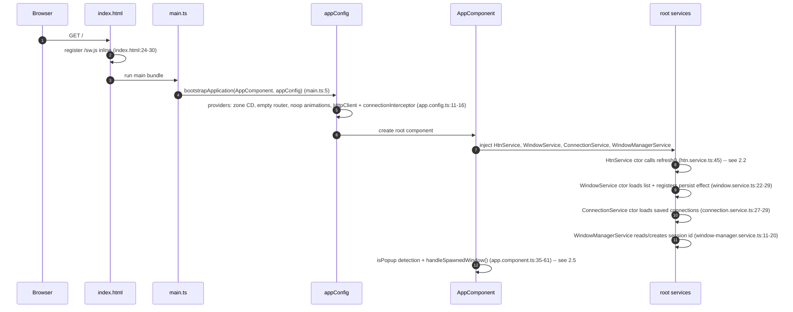
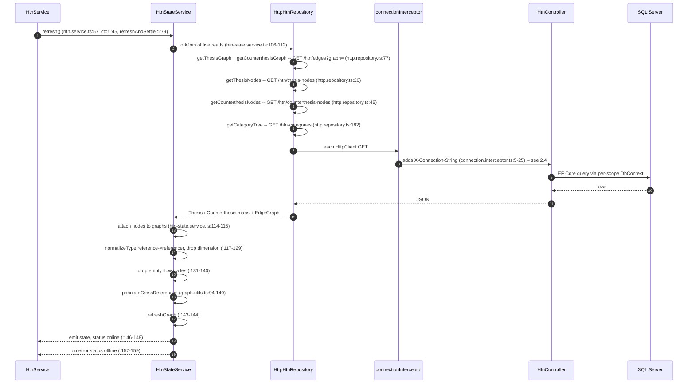
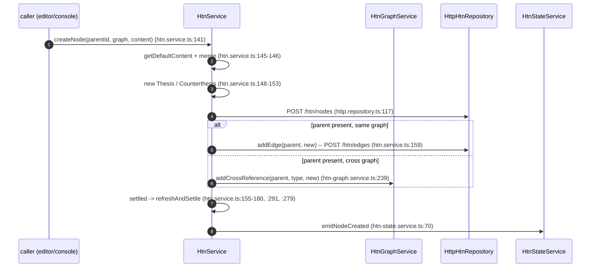
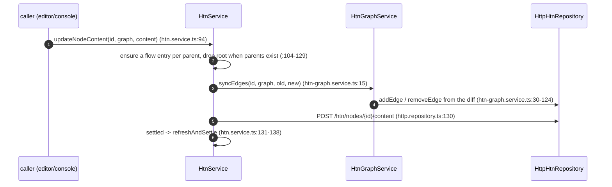
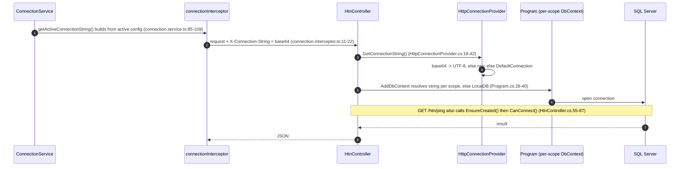
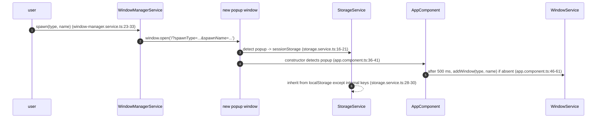

# ERE Architecture — 01 Overview

> Part 1 of 7 · owns §1–§2 · index: `00_index.md`

## 1. Repository Layout

```
ere-infra/                         # integration/infra root — itself a git repo
├── AGENTS.md                      # workflow / context-management rules
├── README.md                      # entry-point doc (corrected in T7.1)
├── docker-compose.yml             # the whole stack (db / backend / frontend-prod|dev)
├── .gitmodules                    # declares the two submodules
├── backups/                       # bind-mounted into the db container
├── exported-plan.json             # sample data export (nested thesis/process plan)
├── resolution-engine/             # submodule — .NET 9 backend (own .git/)
├── shiny-computing-machine/       # submodule — Angular 20 frontend (own .git/)
└── docs/                          # THIS documentation set
    ├── architecture/              # this reference — split into parts (D16; entry: 00_index.md)
    │   ├── 00_index.md            # section -> file map (read first)
    │   ├── 01_overview.md         # §1–§2 (this file)
    │   ├── 02_backend.md          # §3.1–§3.4
    │   ├── 03_backend_reference.md# §3.5–§3.6
    │   ├── 04_frontend.md         # §4.1–§4.3, §4.5
    │   ├── 05_frontend_core.md    # §4.6–§4.7
    │   ├── 06_infrastructure.md   # §5–§7
    │   └── 07_frontend_features.md# §4.4 (feature references)
    ├── PROJECT_STATE.md
    ├── ROADMAP.md
    ├── DECISIONS.md
    ├── CURRENT_TASK.md
    └── PRODUCTION_CHECKLIST.md
```

The two halves are independently versioned: each submodule has its own `.git/` and is wired in
via `.gitmodules`; the root repo is the only place that sees the whole system (D1).

- **`resolution-engine`** — REST API; dev host `http://localhost:5250`, in-container `:8080`.
- **`shiny-computing-machine`** — browser SPA (project/package `purgatory-ui`); dev server
  `:4250` (`npm start`, `package.json:8`), production served by nginx on `:4200→80`.
- **SQL Server 2022** — container `:1433`, named volume `mssql_data`.

## 2. System Context / Data Flow

```
                         ┌──────────────────────────────────────────────┐
                         │        browser SPA: purgatory-ui             │
                         │  Angular 20 · signals · window system        │
                         │  graph algorithms (core/domain/graph.utils)  │
                         └───────────────┬──────────────────────────────┘
                                         │ HTTP/JSON
                                         │ X-Connection-String: <base64 or raw conn string>
                                         ▼
                         ┌──────────────────────────────────────────────┐
                         │        resolution-engine (.NET 9)            │
                         │  Controllers → EF Core (ApplicationDbContext)│
                         │  connection resolved PER REQUEST             │
                         └───────────────┬──────────────────────────────┘
                                         │ SQL (Microsoft.Data.SqlClient)
                                         ▼
                         ┌──────────────────────────────────────────────┐
                         │   SQL Server 2022 (Docker :1433)             │
                         │   HtnNodes · HtnEdges · HtnCategoryDoc       │
                         └──────────────────────────────────────────────┘
```

Load-bearing facts:

- **The DB connection is resolved per request.** The SPA may attach an `X-Connection-String`
  header (base64 or raw) on every call; the backend prefers it, then falls back to config
  `DefaultConnection`, then to LocalDB. This is the distinctive multi-tenant / multi-database
  seam and the reason a DbContext is built per scope (`resolution-engine/Program.cs:28-40`,
  `resolution-engine/Services/HttpConnectionProvider.cs:18-42`). See §3.4.
- **The graph algorithms live in the SPA, not the backend.** Topological layering and
  thesis/counterthesis cross-reference population are in
  `shiny-computing-machine/src/app/core/domain/graph.utils.ts` (D6). The backend only stores
  nodes/edges and an opaque `layer` blob.
- **No authentication anywhere.** There are no identity, token, or CORS-restriction seams; the
  API is open (see §6).
- `exported-plan.json` at the root is a sample data export (a nested thesis/process plan), not
  source.

### 2.1 SPA bootstrap & shell

Startup order (all paths are relative to `shiny-computing-machine` unless noted):



- `provideRouter(routes)` is configured, but `app.routes.ts` is **empty** (`app.routes.ts:3`), so
  `<router-outlet />` renders nothing; the app is one shell (D12).
- The shell renders every open window from `WINDOW_REGISTRY` via `ngComponentOutlet`
  (`core/config/window-registry.ts:10-18`), so a feature component is constructed only when a
  window of its type is open.
- `WindowService` auto-persists the window list on every change through an `effect`
  (`window.service.ts:26-28`) via `StorageService` (localStorage, or sessionStorage in popups —
  §2.5).

### 2.2 Read path — the refresh pipeline

`refresh()` is the single read entry point. It is triggered from the `HtnService` constructor
(`htn.service.ts:45`), from explicit `refresh()` calls (`htn.service.ts:57`), and after every
write via `refreshAndSettle()` (`htn.service.ts:279-289`).



- The five requests run in parallel (`forkJoin`); the state is only emitted once all succeed —
  any failure moves the connection status to `offline` and leaves the previous state in place.
- `getThesisNodes`/`getCounterthesisNodes` map raw JSON into `Thesis`/`Counterthesis`
  (`http.repository.ts:25-32,50-57`); the graph reads build adjacency lists
  (`http.repository.ts:88-93`).

### 2.3 Write path — create and update

**Create** (`createNode`):



**Update** (`updateNodeContent`):



- **Edge direction** depends on graph and field (`htn-graph.service.ts:30-50`): thesis
  `triggers` → `addEdge(id, target)` and `effects` → `addEdge(effect, id)`; counterthesis
  `triggers` → `addEdge(trigger, id)` and `effects` ->`addEdge(id, effect)`. Cross-list
  membership (`countertheses`/`theses`) is mirrored through `addCrossReference`.
- **Deletes** go through `performComplexRemoval` (mode `recursive`/`subtree`/`cascade`,
  `htn-graph.service.ts:301-340`) and batch-delete (`http.repository.ts:149`); the backend
  cascades the corresponding edges (§3.2).
- `importNodes` (`htn.service.ts:310-345`) runs the same create/update primitives per node in a
  single `forkJoin`.

### 2.4 Connection resolution + ping / `EnsureCreated`

The client half is the interceptor; the server half is `HttpConnectionProvider`. Ping is the
bootstrap probe used to create/verify a database.



- A header value that is not valid base64 is used verbatim as the raw connection string
  (`HttpConnectionProvider.cs:33-37`).
- `ping` is the only path that **creates** schema on a fresh database (`EnsureCreated()`,
  `HtnController.cs:68`); `debug-connection` echoes the masked string and all headers
  (`:89-98`) — see §6.

### 2.5 Window spawn (popup) lifecycle

`WindowManagerService.spawn` opens a real browser popup; the popup detects itself and re-adds
the requested window.



- Popup detection is `window.opener` **or** the `/popup` path **or** a `spawnType` query param
  (`storage.service.ts:16`); the same prefixes drive `AppComponent.isPopup`
  (`app.component.ts:36-41`).
- `EXCLUDED_FROM_INHERITANCE` (`shiny_session_id`, `shiny_window_registry`, `shiny_window_list`,
  `shiny_dock_config`) is never inherited from localStorage into a popup
  (`storage.service.ts:8-13`).

### 2.6 Vocabulary & domain code map

Quick map from the project's domain vocabulary to the code that defines each term. Every row
cites the type, DB column, route, or file where the term lives; expand there. Terms are recorded
verbatim as they appear in code (D4).

| Term | Meaning | Where it lives (type / column / route / file) |
| --- | --- | --- |
| **ERE** — Explicit Resolution Engine | The whole system. | `README.md:1`; apps `resolution-engine` (backend) and `purgatory-ui` (Angular frontend) (`README.md:9-10`). |
| **HTN** — Hierarchical Task Network | The planning model the domain is inspired by. | `README.md:14`; `NODE_TYPES` (`types.ts:9`). |
| **GraphType** | The two graph kinds: `'thesis' \| 'counterthesis'`. | `types.ts:7`. |
| **Thesis** | A structure / regularity / static element. | `IThesis` `types.ts:93-98`; class `Thesis` `models.ts:3-22`; DB `HtnNodes.Graph == "thesis"`; route `GET /api/htn/thesis-nodes` (`HtnController.cs:18`). |
| **Counterthesis** / **Antithesis** (alias) | A process / condition / data-flow element. Canonical value is `"counterthesis"`; `"antithesis"` is kept as a compatibility alias on read (D4). | `ICounterthesis` `types.ts:100-105`; class `Counterthesis` `models.ts:24-45`; alias matched in `HtnController.cs:25-30`. |
| **Node** | One vertex, either a thesis or a counterthesis. | `HtnNode = IThesis \| ICounterthesis` `types.ts:23`; backend `HtnNodeModel` table `HtnNodes` (`Models/HtnNode.cs`); route `nodes/{id}`. |
| **Edge** | A directed `[from, to]` pair. | `Edge = [string, string]` `types.ts:3`; backend `HtnEdgeModel` (`FromId`/`ToId`/`Graph`) `Models/HtnEdge.cs`; route `edges`. |
| **Graph** | A set of nodes + edges with forward/reverse adjacency. | `Graph` `types.ts:25-32` (`edges`, `ady`, `inv`, `nodes`); rebuilt by `rebuildAdjacency` `graph.utils.ts:6-17`. |
| **Adjacency** (`ady` / `inv`) | Forward / reverse `Map<nodeId, nodeId[]>` on a `Graph`. | `types.ts:27-28`; `graph.utils.ts:6-17`. |
| **Layer** / **`LayerMetrics`** | Topological depth of a node: `{longestPath, shortestPath, avg}`. Persisted, but computed client-side (D6/D10). | `LayerMetrics` `types.ts:87-91`; `LayerJson` → `Layer` `Models/HtnNode.cs:30-50`; `computeTopology` `graph.utils.ts:19-85`. |
| **Flow** / **`FlowState`** | Per-parent execution state map `flow: Record<parentId, FlowState>`. | `FlowStateBase` `types.ts:52-55`; `FlowStateThesis` `types.ts:78`; `FlowStateCounterthesis` (adds `completed`, `completedCondition`, `cycles?`, `analyzes?`) `types.ts:62-67`. |
| **Trigger** | Inbound reference (the node is activated by it). | `triggers: string[]` `types.ts:46`; synthesized in `computeTopology` `graph.utils.ts:36-42`. |
| **Effect** | Outbound reference (the node activates it). | `effects: string[]` `types.ts:47`; synthesized in `computeTopology` `graph.utils.ts:37-42`. |
| **Referencer** | A node (`type: 'referencer'`) that points at another via `refId`; the target accumulates `referencers`. | `graph.utils.ts:132-139`; `populateCrossReferences` `graph.utils.ts:94-140`. |
| **Category** / **`CategoryList`** | The user's category tree over nodes. | `CategoryList` `types.ts:107-116`; backend singleton `HtnCategoryDoc` (id `"main"`, `JsonData`) `Models/HtnCategoryDoc.cs:6-12`; route `htn-categories`. |
| **Node content** | The untyped JSON payload of a node. | `NodeContentBase` / `NodeContentRoot` `types.ts:42-50`; full field schema in §3.5. |
| **Plan** / **`PlanStep`** / **`PendingAnalysis`** | The plan view's step tree (`type: 'step' \| 'loop'`). | `features/htn-plan/plan.types.ts:3-28`; view in §4.4. |
| **Window** | A floating/closable UI panel. | `WindowService` (list, z-index), `WindowManagerService` (popups); `WINDOW_REGISTRY` types `window-registry.ts:10-18`; §4.2. |
| **Dock** | Pinning a window to a region: `left` / `right` / `top` / `bottom` / `center`. | `DockablePanelsService` `dockable-panels.service.ts:11-15`; persisted under `shiny_dock_config` (`:207`). |
| **Connection string** / **`X-Connection-String`** | Per-request target DB; the SPA attaches the header, the backend resolves it (D7). | `connection.interceptor.ts`; `Services/HttpConnectionProvider.cs:18-42`; `ConnectionService`; §2.4. |

