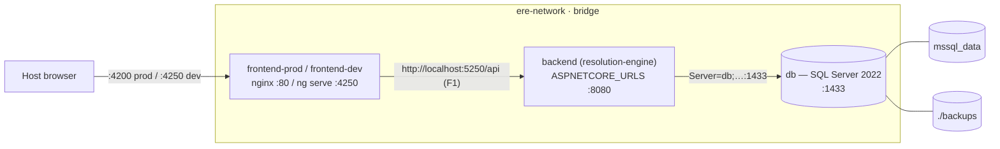

# ERE Architecture — 06 Infrastructure & Gaps

> Part 6 of 7 · owns §5–§7 · index: `00_index.md`

## 5. Infrastructure, containers & deployment topology

### 5.1 Containers, images & topology

`docker-compose.yml` (root) defines one network `ere-network` (bridge) and four services:

| Service | Image / build | Ports | Profile | Notes |
|---|---|---|---|---|
| `db` | `mcr.microsoft.com/mssql/server:2022-latest` | `1433:1433` | — | `MSSQL_SA_PASSWORD` defaults to `Password123!` (`:7`); volume `mssql_data` + bind `./backups` (`:13-14`). |
| `backend` | build `./resolution-engine` | `5250:8080` | — | `ASPNETCORE_ENVIRONMENT=Development`, `ASPNETCORE_URLS=http://+:8080`, `ConnectionStrings__DefaultConnection=Server=db;…;Password=${MSSQL_SA_PASSWORD}` (`:21-24`). |
| `frontend-prod` | build `./shiny-computing-machine` (Dockerfile) | `4200:80` | `prod` | Angular build → nginx. |
| `frontend-dev` | build `./shiny-computing-machine` (Dockerfile.dev) | `4250:4250` | `dev` | bind-mount source + anonymous `/app/node_modules`; `--poll 2000` (`Dockerfile.dev:17`). |

**Backend `Dockerfile`** (`resolution-engine/Dockerfile`): multi-stage `dotnet/sdk:9.0` build →
`aspnet:9.0` runtime, non-root `$APP_UID`. **Frontend `Dockerfile`** (`shiny-computing-machine/Dockerfile`):
`node:20-alpine` build → `nginx:stable-alpine`, serving the SPA via `nginx.conf`. The per-stage
detail, `EXPOSE`/entrypoint facts and the nginx rules are in **§5.3**.

#### File anatomy

`docker-compose.yml` is a single Compose-Spec file (**no** `version:` key) with three top-level
keys: `services` (`:1`), `networks` (`:63`) and `volumes` (`:67`). There is **no**
`docker-compose.override.yml` and **no** `.env` file (the root `.gitignore` ignores only
`backups/`, `.gitignore:1`), so `${…}` interpolation uses only the ambient environment plus the
inline defaults shown below.

#### Service reference

**`db`** — SQL Server 2022 (`:2-14`)

| Key | Value | Line |
|---|---|---|
| `image` | `mcr.microsoft.com/mssql/server:2022-latest` | `:3` |
| `container_name` | `ere-db` | `:4` |
| `environment` | `ACCEPT_EULA=Y`; `MSSQL_SA_PASSWORD=${MSSQL_SA_PASSWORD:-Password123!}` | `:6-7` |
| `ports` | `1433:1433` | `:9` |
| `networks` | `ere-network` | `:10-11` |
| `volumes` | `mssql_data:/var/opt/mssql` (named); `./backups:/var/opt/mssql/backup` (bind) | `:13-14` |

**`backend`** — `resolution-engine` API (`:16-30`)

| Key | Value | Line |
|---|---|---|
| `build` | context `./resolution-engine`, `dockerfile: Dockerfile` | `:17-19` |
| `container_name` | `resolution-engine` | `:20` |
| `environment` | `ASPNETCORE_ENVIRONMENT=Development`; `ASPNETCORE_URLS=http://+:8080`; `ConnectionStrings__DefaultConnection=Server=db;Database=ResolutionEngineDb;User Id=sa;Password=${MSSQL_SA_PASSWORD:-Password123!};TrustServerCertificate=True` | `:22-24` |
| `ports` | `5250:8080` | `:26` |
| `depends_on` | `db` | `:27-28` |
| `networks` | `ere-network` | `:29-30` |

**`frontend-prod`** — nginx-served SPA (`:33-44`)

| Key | Value | Line |
|---|---|---|
| `profiles` | `["prod"]` | `:34` |
| `build` | context `./shiny-computing-machine`, `dockerfile: Dockerfile` | `:35-37` |
| `container_name` | `shiny-ui-prod` | `:38` |
| `ports` | `4200:80` | `:40` |
| `depends_on` | `backend` | `:41-42` |
| `networks` | `ere-network` | `:43-44` |

**`frontend-dev`** — Angular dev server (`:47-61`)

| Key | Value | Line |
|---|---|---|
| `profiles` | `["dev"]` | `:48` |
| `build` | context `./shiny-computing-machine`, `dockerfile: Dockerfile.dev` | `:49-51` |
| `container_name` | `shiny-ui-dev` | `:52` |
| `ports` | `4250:4250` | `:54` |
| `volumes` | `./shiny-computing-machine:/app` (bind); `/app/node_modules` (anonymous) | `:56-57` |
| `depends_on` | `backend` | `:58-59` |
| `networks` | `ere-network` | `:60-61` |

#### Profiles & start order

| Command | Services started | Source |
|---|---|---|
| `docker-compose up -d db backend` | `db`, `backend` (no profile) | `README.md:41` |
| `docker-compose --profile dev up frontend-dev` | `db`, `backend`, `frontend-dev` (`dev`) | `README.md:44,46` |
| `docker-compose --profile prod up frontend-prod` | `db`, `backend`, `frontend-prod` (`prod`) | `README.md:51,52` |

- `db` and `backend` carry **no** `profiles:` key, so they always start; the two frontends are
  opt-in via `dev` / `prod`.
- **Start order** (`depends_on`, start-only): `backend → db` (`:27-28`),
  `frontend-prod → backend` (`:41-42`), `frontend-dev → backend` (`:58-59`).

#### Network & volumes

- **`ere-network`** — one user-defined `bridge` network (`:64-65`); all four services attach
  (`:10-11,29-30,43-44,60-61`), so service-name DNS (`db`, `backend`) resolves between containers.
- **`mssql_data`** — a named volume (`:68`) mounted at `/var/opt/mssql` (`:13`), persisting the
  database across `down`/`up`.
- **`./backups`** — a host bind mount (`:14`) into `/var/opt/mssql/backup`; git-ignored
  (`.gitignore:1`).

#### Environment wiring

- `MSSQL_SA_PASSWORD` drives **both** the SQL Server password (`db`, `:7`) and the backend's
  connection string (`:24`) through the shared `${MSSQL_SA_PASSWORD:-Password123!}` substitution;
  the password appears in the file only as that fallback default.
- The backend reaches SQL Server by **service name** (`Server=db;…`), not `localhost`, because both
  sit on `ere-network`. Full settings matrix: **§5.2**.

#### Container topology

#### Compose realities (current behaviour, not intent)

- **No healthchecks; `depends_on` is start-order only.** No service declares `healthcheck:`, so
  compose waits for the dependency container to *start*, not to become ready — the backend can race
  SQL Server's first boot, and a frontend can start before the API answers.
- **Fixed `container_name`s** (`ere-db`, `resolution-engine`, `shiny-ui-prod`, `shiny-ui-dev`)
  prevent scaling any service to more than one replica.
- **No `restart:` policy** on any service, so containers stay stopped after a host reboot or crash
  until re-run manually.
- **Unpinned / dev defaults** — the `:latest` SQL image (`:3`), the default `Password123!` (`:7`)
  and the host-published `1433` (`:9`) are production risks (`PRODUCTION_CHECKLIST.md` §4); the
  backend also runs `ASPNETCORE_ENVIRONMENT=Development` (`:22`, row **B6**).
- **Dev volume layering** — the source bind (`:56`) is overlaid by an anonymous volume at
  `/app/node_modules` (`:57`) so the image's installed modules survive the mount.

### 5.2 Configuration & ports matrix

Every runtime setting and port, with where each value comes from. Unless noted, values are read
from the backend's `appsettings*.json` / `launchSettings.json` / `docker-compose.yml` or the
frontend's `angular.json` / `package.json` / `core/config/app-config.ts`.

**Settings**

| Setting | Dev (local) | Container / prod | Source |
|---|---|---|---|
| `ASPNETCORE_ENVIRONMENT` | `Development` (both launch profiles) | `Development` | `launchSettings.json:10,19`; `docker-compose.yml:22` |
| `applicationUrl` (launch profile) | http `http://0.0.0.0:5250`; https `https://0.0.0.0:7150;http://0.0.0.0:5250` | — (uses `ASPNETCORE_URLS`) | `launchSettings.json:8,17` |
| `ASPNETCORE_URLS` | — | `http://+:8080` | `docker-compose.yml:23` |
| `ConnectionStrings:DefaultConnection` | placeholder `Server=YOUR_SERVER;Database=YOUR_DATABASE;Trusted_Connection=True;TrustServerCertificate=True` | `Server=db;Database=ResolutionEngineDb;User Id=sa;Password=${MSSQL_SA_PASSWORD};TrustServerCertificate=True` | `appsettings.json:10`; `docker-compose.yml:24` |
| LocalDB fallback | in-code, only when the resolved string is **empty**: `Server=(localdb)\mssqllocaldb;Database=ResolutionEngineDb;Trusted_Connection=True;MultipleActiveResultSets=true` | same | `Program.cs:36` |
| `MSSQL_SA_PASSWORD` | — (consumed by `db` `:7` and the backend connection string `:24`) | `${MSSQL_SA_PASSWORD:-Password123!}` | `docker-compose.yml:7,24` |
| `AllowedHosts` | `*` | `*` | `appsettings.json:8` |
| `Logging:LogLevel` | `Default=Information`, `Microsoft.AspNetCore=Warning` | same | `appsettings.json:2-7`; `appsettings.Development.json:2-7` |
| CORS policy `AllowAngularDev` | any origin, any header, any method | same | `Program.cs:7-16` |
| `APP_CONFIG.apiUrl` | `http://localhost:5250/api` | same — **hardcoded, no env replacement** | `app-config.ts:2` |
| Angular build/serve config | serve default `development`; build default `production` (`outputHashing: all`, budgets) | same | `angular.json:53,61,73` |
| npm script hooks | `prestart`/`prebuild`/`prewatch` run `scripts:index` first | same | `package.json:6-13` |

**Ports**

| Port | Process / service | Dev (host) | Container | Source |
|---|---|---|---|---|
| `5250` | backend HTTP | API on `0.0.0.0:5250` | host `5250` → container `8080` | `launchSettings.json:8`; `docker-compose.yml:26` |
| `7150` | backend HTTPS | https launch profile only (unused by the SPA) | — | `launchSettings.json:17` |
| `8080` | backend in-container | — | `ASPNETCORE_URLS=http://+:8080` | `docker-compose.yml:23`; `Dockerfile:17` |
| `8081` | backend (declared only) | — | `EXPOSE`d with no bound URL | `Dockerfile:18` |
| `1433` | SQL Server 2022 | `1433:1433` | `1433:1433` | `docker-compose.yml:9` |
| `4250` | Angular dev server | `ng serve` (`npm start`) | `frontend-dev` `4250:4250` | `package.json:8`; `angular.json:75`; `docker-compose.yml:54` |
| `4200` | frontend prod (host) | — | `4200` → nginx `80` | `docker-compose.yml:40` |
| `80` | nginx (`frontend-prod`) | — | in-container web root | `Dockerfile:28`; `nginx.conf:2` |

- **Profiles & volumes** (defined in §5.1): `db`/`backend` are always on; `frontend-prod` is the
  `prod` profile, `frontend-dev` the `dev` profile; data persists in the `mssql_data` volume with
  `./backups` bind-mounted.
- **No committed `.env`.** `MSSQL_SA_PASSWORD` is supplied by the environment and falls back to
  `Password123!`; the root `.gitignore` ignores only `backups/`.
- **Host vs container ports.** The API is `:5250` on the host in both modes (dev binds it
  directly; compose maps host `5250 → 8080`). The SPA's hardcoded `http://localhost:5250/api`
  therefore resolves from a host browser even against the prod frontend container (§6 item 6).
- **HTTPS is dev-host only.** The `:7150` https profile is unused by the SPA, and the container
  sets `ASPNETCORE_ENVIRONMENT=Development`, so `UseHttpsRedirection()` stays off
  (`Program.cs:53-56`); `EXPOSE 8081` in the image has no matching URL.
- **`ConnectionStrings__DefaultConnection` is the container seam**; on the host the committed
  placeholder is what the API would use absent an `X-Connection-String` header, so LocalDB is
  reached only when the resolved string is empty (§5.2 settings table, `Program.cs:34-37`).

### 5.3 Container image reference — Dockerfiles & nginx

The images built by the two submodules' Dockerfiles (§5.1 builds), stage by stage.

**`resolution-engine/Dockerfile`** (backend, 2 stages, 28 lines)

| Stage | Base image | Steps | Output |
|---|---|---|---|
| `build` | `mcr.microsoft.com/dotnet/sdk:9.0` (`:3`) | `WORKDIR /src` (`:4`); cache layer `COPY ResolutionEngine.csproj` + `dotnet restore` (`:7-8`); `COPY . .` + `dotnet publish -c Release -o /app/publish /p:UseAppHost=false` (`:11-12`) | app published to `/app/publish` |
| `final` | `mcr.microsoft.com/dotnet/aspnet:9.0` (`:15`) | `WORKDIR /app` (`:16`); `EXPOSE 8080` (`:17`), `EXPOSE 8081` (`:18`); `USER $APP_UID` (`:21`); `COPY --from=build /app/publish .` (`:23`) | `ENTRYPOINT ["dotnet","ResolutionEngine.dll"]` (`:28`) |

- **Non-root.** `USER $APP_UID` (`:21`) drops root to the base image's app user — the only one of
  the three images that does (the nginx images have no `USER` directive and run as root).
- **Ports.** `EXPOSE 8080` matches the compose `ASPNETCORE_URLS=http://+:8080`; `EXPOSE 8081` is
  declared with **no** bound URL (the container listens only on `ASPNETCORE_URLS`) — see §5.2.
- **`(localdb)` warning.** The header comment (`:25-27`) states `(localdb)` connection strings do
  **not** work in-container and a real `ConnectionStrings__DefaultConnection` must be supplied
  (§5.2; production row B3).
- **`.dockerignore`** (`resolution-engine/.dockerignore:1-10`) excludes `**/bin`, `**/obj`,
  `**/out`, `*.log`, `build_log.txt`, `build_output.txt` — and also `Dockerfile` and
  `.dockerignore` themselves, so neither enters the `COPY . .` context.

**`shiny-computing-machine/Dockerfile`** (frontend prod, 2 stages, 29 lines)

| Stage | Base image | Steps | Output |
|---|---|---|---|
| `build` | `node:20-alpine` (`:2`) | `WORKDIR /app` (`:3`); `COPY package*.json` + `npm ci` (`:6-7`); `COPY . .` (`:10`); `npm run build -- --configuration production` (`:13`) | Angular bundle in `dist/purgatory-ui/browser` |
| `exec` | `nginx:stable-alpine` (`:16`) | purge default web root (`:19`); `COPY nginx.conf /etc/nginx/conf.d/default.conf` (`:22`); `COPY --from=build /app/dist/purgatory-ui/browser /usr/share/nginx/html` (`:26`) | `EXPOSE 80` (`:28`); `CMD ["nginx","-g","daemon off;"]` (`:29`) |

- The build carries a comment flagging the **hardcoded API URL** (`:11-12`; production row **F1**).
- The artifact path hardcodes the Angular project name `purgatory-ui` (`:25-26`; D16/`angular.json`).
- This image runs as **root** (no `USER`), in contrast to the backend image.
- **`.dockerignore`** (`shiny-computing-machine/.dockerignore:1-8`) excludes `node_modules`,
  `dist`, `.angular`, `.git`, `.editorconfig`, `.eslintrc.js`, `*.log`.

**`shiny-computing-machine/Dockerfile.dev`** (frontend dev, 1 stage, 17 lines)

| Base image | Steps | Runtime |
|---|---|---|
| `node:20-alpine` (`:2`) | `WORKDIR /app` (`:3`); `COPY package*.json` + `npm ci` (`:6-7`); `COPY . .` (`:10`) | `EXPOSE 4250` (`:13`); `CMD ["npm","start","--","--host","0.0.0.0","--disable-host-check","--poll","2000"]` (`:17`) |

- `--poll 2000` (`:16-17`) exists for file-change detection under Docker on Windows/WSL2; compose
  bind-mounts the source over `/app` and preserves `/app/node_modules` anonymously (§5.1).

**`nginx.conf` rules** (`shiny-computing-machine/nginx.conf`, mounted as `default.conf`)

| Rule | Directive | Effect | Line |
|---|---|---|---|
| Server / web root | `listen 80; server_name localhost; root /usr/share/nginx/html; index index.html` | serves the built SPA on `:80` | `:2-5` |
| SPA fallback | `location / { try_files $uri $uri/ /index.html; }` | unknown paths fall back to `index.html` (client routing) | `:7-9` |
| Static assets | `location ~* \.(?:ico\|css\|js\|gif\|jpe?g\|png\|woff2?\|eot\|ttf\|svg\|json)$` → `expires 6M; access_log off; add_header Cache-Control "public"` | 6-month cache for hashed assets; no access log | `:12-16` |
| Script manifest | exact `location = /scripts/index.json` → `expires -1; add_header Cache-Control "no-store, no-cache, must-revalidate"` | the regenerated manifest is never cached | `:20-23` |
| Error page | `error_page 500 502 503 504 /50x.html` + `location = /50x.html` | static 50x page from the web root | `:25-28` |

- The static-asset regex (`:12`) would also match `/scripts/index.json`, but the **exact `=`**
  location (`:20`) takes precedence — the config comment states this (`:18-19`), and it is the
  manifest-freshness half of production row **F2**.

## 6. Known gaps, assumptions & unknowns register (current behaviour, not intent)

This register folds the buildout's deep-dive findings into one place. Items are tagged with their
kind: **`GAP`** — a verifiable behaviour that diverges from what the code implies it should do;
**`ASSUMPTION`** — inferred from the code (e.g. "no consumer") but not provable intent;
**`UNKNOWN`** — cannot be resolved from the repository alone. Production-relevant items carry their
route (`→ row Bx/Fx`) into `docs/PRODUCTION_CHECKLIST.md`; dev-only items become future tickets.
Items 1–14 predate the taxonomy and are untagged. The subset that contradicts the entry-point docs
is corrected in T7.1.

1. **The entry-point docs *were* stale (fixed in T7.1, 2026-10-10).** Before that, `README.md`
   and the now-removed `DOCUMENTATION.md` (D15) claimed .NET **8** and Angular **18**; the code
   is .NET **9** (`ResolutionEngine.csproj:4`) and Angular **20** (`package.json:18`). The former
   file also claimed "custom polymorphic converters" (**none exist** — content is untyped JSON,
   §3.3/§3.5), named the endpoint `antithesis-nodes` (it is `counterthesis-nodes`, with
   `antithesis` as an alias, §3.2), and placed topological analysis in the backend (it is in the
   frontend, §4.6). All of these are corrected, and the redundant file is gone.
2. **No authentication / authorization** on any backend endpoint, and CORS is fully open
   (`Program.cs:12`). Combine with `debug-connection` exposing masked connection strings and all
   request headers (`HtnController.cs:89-98`).
3. **No migrations and unwired seeding.** Schema comes from `EnsureCreated()`; there is no
   `Migrations/`, and `DbInitializer.Initialize` is never called from `Program.cs`, so a fresh
   container DB starts empty. `EnsureCreated` cannot evolve an existing schema (hence
   `cleanup_weight_column.sql`).
4. **No backend tests.** The frontend has 21 specs; the backend has none.
5. **Reference data is stringly-typed.** Graph kind, `type`, `state`, etc. are untyped JSON
   strings in the DB; there are no enum columns, FKs, or indexes.
6. **Hardcoded frontend API URL** (`core/config/app-config.ts:2`) with no environment
   replacement — the prod build still targets `localhost:5250`.
7. **Empty router / dead outlet.** `app.routes.ts` is empty and `<router-outlet />` renders
   nothing; the whole app is one shell.
8. **Two test frameworks coexist** (Jasmine/Karma and Jest) — see `package.json:36-46` and the
   Jest builder in `angular.json:82-89`.
9. **Flow `condition` defaulting is inconsistent.** `HtnService.updateNodeContent` seeds a
   missing parent flow entry with `condition: ''` for **both** graphs
   (`htn.service.ts:109,122`), whereas `HtnGraphService.ensureFlowEntries` and
   `HtnValidationService.getDefaultContent` default counterthesis entries to `'next'`
   (`htn-graph.service.ts:275`; `htn-validation.service.ts:73`). A flow entry's initial
   `condition` therefore depends on which code path created it.
10. **`createNode` passes `parentGraph`, not the node's own graph, to the edge call.**
    When `newNodeGraph` differs from `parentGraph`, the same-graph branch still compares against
    `parentType` but forwards `parentGraph` to `addEdge` (`htn.service.ts:158-168`); the intent
    is correct, but the argument is easy to misread.
11. **`PwaService` is dead code.** `core/services/pwa.service.ts` implements the install-prompt
    lifecycle (`beforeinstallprompt`/`promptInstall`, `pwa.service.ts:11-46`) but is injected
    nowhere — no component or service references it (only its own file does), so the PWA install
    UI it backs is unreachable. The service worker itself is registered separately in
    `src/index.html:24-30` (§4.6), so the app is still a PWA; only the in-app prompt is dead.
12. **The `HtnRepository` port is decorative.** No consumer injects the `HtnRepository` interface;
    the three services inject the concrete `HttpHtnRepository` (`htn.service.ts:20`,
    `htn-graph.service.ts:12`, `htn-state.service.ts:23`). The interface also **omits**
    `getCategoryTree`/`saveCategoryTree`, which exist only on the class. It documents the HTTP
    contract but is not a swappable seam (§4.3).
13. **Mobile dock enforcement is partial.** `DockablePanelsService.enforceMobileLayout` only raises
    `bottomHeight` and docks `console`; its own comments state that other windows are **not**
    systematically reflowed or re-docked on the mode switch (`dockable-panels.service.ts:99-122`).
    `checkMobileMode` also ships verbose `console.log` diagnostics (UA/pointer/portrait/screen
    details) on **every** evaluation — including window resize and orientation changes (`:76-82`).
    Dock/undock tightens this per-window, but the initial reflow is incomplete (§4.2).
14. **`.eslintrc.js` is syntactically invalid and unwired.** The config ends in a stray pair of
    backticks (`shiny-computing-machine/.eslintrc.js:9`), so Node cannot `require()` it; there is
    **no `lint` script** in `package.json` and **no `lint` target** in `angular.json`, so ESLint is
    configured but never invoked. It is dead scaffolding rather than an active seam (§4.6;
    frontend dead-scaffolding bullet).
15. **[GAP → row F4] Console output is rendered as trusted HTML.** `SafeHtmlPipe` is defined
    inline in the console and returns `bypassSecurityTrustHtml(...)`
    (`features/console/console.component.ts:10-13`); the template binds `[innerHTML]`
    (`console.html:3`). Only the referencer, script and view handlers escape dynamic text via
    `ctx.escapeHtml`; most node/category output interpolates DB strings verbatim (§4.5). Combined
    with the unauthenticated write surface (item 2), graph/plan content is a stored-injection
    surface.
16. **[GAP → row B1] Connection credentials are persisted in cleartext.** `persist()` writes the
    whole connections array — including any `user`/`password` — as JSON to `localStorage`
    (`core/services/connection.service.ts:81-83`), and passwords travel `btoa`-encoded only (not
    encrypted) in `X-Connection-String` (`connection-string-manager.ts:86-87`). This is the client
    half of the per-request connection seam (§4.4 / PRODUCTION_CHECKLIST B1).
17. **[GAP] Offline gating is advisory only.** `connectionStatus$` toggles the private `isOnline`
    flag and logs "System is OFFLINE" (`console.handler.ts:114-119`), but `isOnline` (`:39`) is
    never read, so no console command is actually blocked; only the script engine's `online|offline`
    guards consult connection state (`script.handler.ts:69,88-89,384-387`). The "modification
    commands are disabled" message is aspirational.
18. **[GAP → row F5] Feature-path `console.log` dumps ship in production builds.** The plan
    editor logs graph type / before-and-after content / validation result on save plus every
    keystroke (`htn-editor.component.ts:288-296,476-478`), the explorer logs on data receive and
    state init (`htn-explorer.component.ts:272,283`, "[HtnExplorer]" prefix), and mobile-mode
    evaluation logs UA/pointer/portrait/screen on every resize (item 13,
    `dockable-panels.service.ts:76-82`) — all bypassing the injectable `ConsoleLoggerService`.
19. **[GAP] `layerAvg` always renders `L:0.0`.** `computeTopology` seeds `avg` to `0` and never
    assigns it (`05_frontend_core.md` §4.6), so the graph subtitle's `layerAvg = layer.avg.toFixed(1)`
    is constant; it is also rendered at `htn-explorer.html:281,312` (§4.4).
20. **[GAP] A graph refresh drops stored out-of-graph `triggers`/`effects`.** Phase A overwrites
    `content.triggers`/`content.effects` on every refresh; a stored out-of-graph trigger is moved
    on the first refresh but dropped on the second (§4.6, `05_frontend_core.md`).
21. **[GAP] Legacy explorer-key cleanup is deletion, not migration.** `restoreState` reads the
    per-instance keys and deletes three legacy `htn_explorer_*` keys (`htn-explorer.component.ts:334-336`);
    a user relying on the old `thesis_state`/`counterthesis_state` view continuity loses it (07 §4.4).

## 7. Pointers

- Decisions behind these facts: `docs/DECISIONS.md` (D1–D16).
- Dev-only seams that must be swapped/verified before production: `docs/PRODUCTION_CHECKLIST.md`.
- Current snapshot + next action: `docs/PROJECT_STATE.md`, `docs/CURRENT_TASK.md`.
- Build-out plan for this documentation: `docs/ROADMAP.md`.
- Shipped frontend references (do not duplicate): `shiny-computing-machine/docs/console_script_syntax.md`,
  `shiny-computing-machine/docs/pwa_testing_guide.md`.
